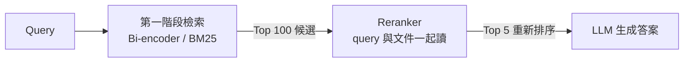
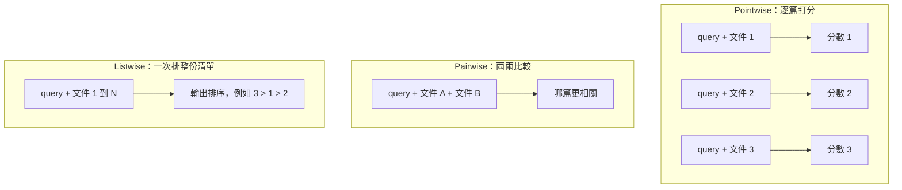
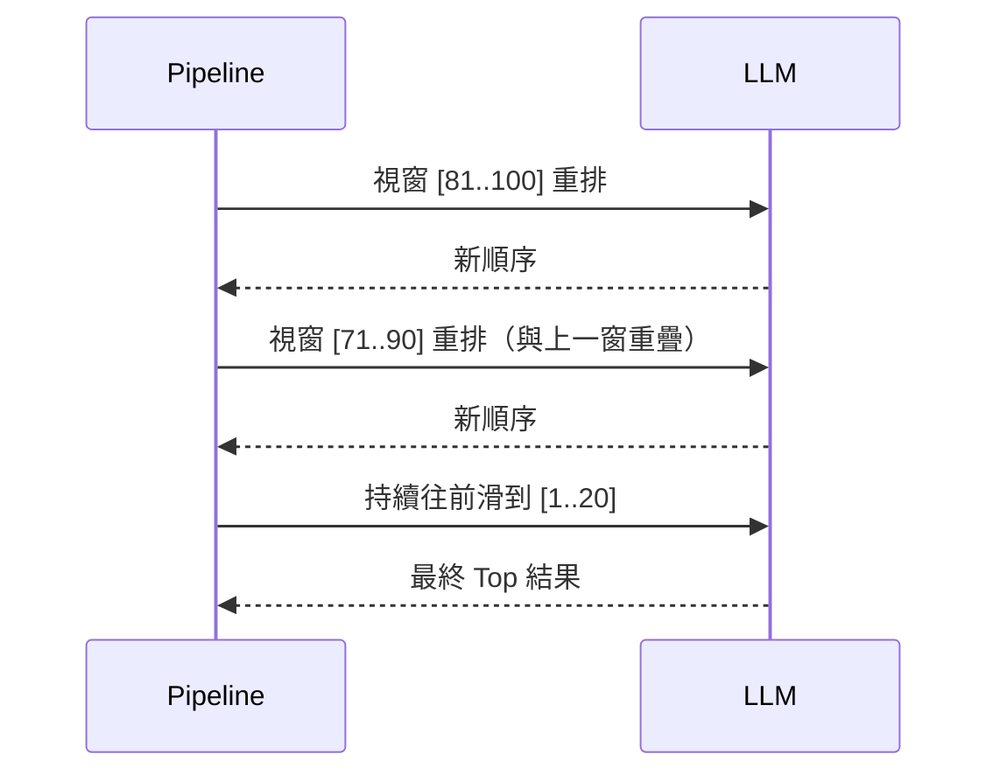

# LLM Rerank 的實現方式：Cross-Encoder 與 LLM 的 Pointwise、Pairwise、Listwise 排序

> 一句話版本：Rerank 就是把 query 與每篇候選文件「放在同一個 context 裡讓模型一起讀」，再輸出相關性分數或排序。實作上有兩條路：訓練專用的 cross-encoder，或直接拿通用 LLM 用 pointwise、pairwise、listwise 三種 prompt 範式來排序。

## Step 1：Rerank 要解決什麼問題

第一階段檢索（向量搜尋、BM25）為了快，query 與文件是**各自獨立編碼**的，彼此之間沒有任何互動，所以只能做粗篩。Rerank 是第二階段：只對少量候選（通常 50～100 筆）做昂貴但精準的比對，再把前 3～10 筆交給生成模型。



關於 RRF（結果融合）與 Rerank 的分工差異，請見 [RRF 與 Rerank 的差異](#/llm/04-applications/rrf-vs-rerank.mdx)。本篇專注在「Reranker 內部到底怎麼做」。

## Step 2：核心差異——為什麼要「一起讀」

| 面向 | Bi-encoder（第一階段） | Cross-encoder / LLM reranker |
|------|------------------------|------------------------------|
| 輸入 | query、文件分開各編碼一次 | query 與文件拼成同一段輸入 |
| 互動 | 只在最後算向量相似度 | 每一層 attention 都能讓 query token 看到文件 token |
| 文件向量 | 可離線預先算好、建索引 | 無法預先算，必須在線上逐對計算 |
| 複雜度 | 文件數量不影響 query 時間（有 ANN 索引） | 每個 (query, 文件) 配對都要跑一次 forward |
| 精度 | 較低 | 較高 |

關鍵在於 **token 層級的互動**：query 裡的「蘋果股價」可以直接 attend 到文件裡的「AAPL 收盤上漲」，模型能判斷「這段文字是否真的在回答這個問題」，而不只是「兩段文字主題相近」。代價是無法預先索引，所以只能用在小規模候選上。

## Step 3：路線一——Cross-Encoder 的實現

### 模型結構

Cross-encoder 通常是一個 encoder（BERT、XLM-R 等）或小型 decoder，輸入把 query 與文件拼接：

```text
[CLS] query tokens [SEP] document tokens [SEP]
```

取 `[CLS]` 的最後一層 hidden state，接一個線性層輸出單一純量，作為相關性分數：

$$
s(q, d) = \mathbf{w}^\top h_{\text{CLS}} + b
$$

推論時對每個候選算出 $s$，由大到小排序即可。

### 訓練方式

訓練資料是 (query, 相關文件, 不相關文件) 的標註，例如 MS MARCO。常見的 loss 有三類：

| Loss 類型 | 做法 | 特點 |
|-----------|------|------|
| Pointwise | 每對 (q, d) 當二元分類，用 BCE | 最簡單，不直接優化排序 |
| Pairwise | 要求相關文件分數高於不相關文件 | 直接優化相對順序 |
| Listwise | 一個正例搭配多個負例做 softmax，用 cross-entropy | 效果通常最好，可用 hard negative |

Listwise 的 InfoNCE 形式如下，其中 $d^+$ 是正例，分母包含正例與所有負例：

$$
\mathcal{L} = -\log \frac{\exp(s(q, d^+))}{\exp(s(q, d^+)) + \sum_{i} \exp(s(q, d_i^-))}
$$

**Hard negative 很重要**：負例要從第一階段檢索「排很前面但其實不相關」的文件挖出來，這正好是 reranker 上線後要面對的分佈。

## Step 4：路線二——用通用 LLM 當 Reranker

不訓練模型，直接用 prompt 讓 LLM 判斷相關性。依「一次給 LLM 看多少文件、要它輸出什麼」分成三種範式：



### 4.1 Pointwise：逐篇打分

每篇文件獨立問一次：「這篇文件能回答 query 嗎？回答 Yes 或 No」。分數不靠模型「講」出來，而是直接讀 **Yes / No 兩個 token 的 logit**，比讓模型輸出數字穩定得多：

$$
s = \log P(\text{Yes}) - \log P(\text{No})
$$

```python
import math

def pointwise_score(llm, query: str, doc: str) -> float:
    prompt = (
        "判斷文件是否能回答問題，只回答 Yes 或 No。\n"
        f"問題：{query}\n文件：{doc}\n答案："
    )
    # 只生成 1 個 token，並取回 Yes / No 的 logprob
    logprobs = llm.next_token_logprobs(prompt, tokens=["Yes", "No"])
    return logprobs["Yes"] - logprobs["No"]

def rerank(llm, query, docs, top_k=5):
    scored = [(pointwise_score(llm, query, d), d) for d in docs]
    scored.sort(key=lambda x: x[0], reverse=True)
    return [d for _, d in scored[:top_k]]
```

優點是每篇互相獨立，可以**完全平行**，也不受 context 長度限制；缺點是分數沒有校準，文件之間不會互相比較。

### 4.2 Pairwise：兩兩比較（PRP）

Pairwise Ranking Prompting 每次給兩篇文件問「哪篇更相關」，再用排序演算法（如 heapsort、bubble sort 的部分輪次）把比較結果組成排序。比較任務對 LLM 最簡單、最準，但呼叫次數是 $O(N \log N)$ 甚至 $O(N^2)$，成本最高。

### 4.3 Listwise：一次排整份清單（RankGPT）

把 N 篇文件加上編號一次放進 prompt，直接要求輸出排序：

```text
以下有 20 篇文件，編號 [1] 到 [20]。
請依與問題「蘋果公司最新財報」的相關程度由高到低排序，
只輸出編號，格式如 [3] > [1] > [2]。
```

- 優點：LLM 能同時看到所有文件，可以做相對比較，只需 1 次呼叫。
- 缺點：受 context 長度限制，且有**位置偏誤**（對清單開頭與結尾較敏感）。
- 解法：**滑動視窗（sliding window）**。例如視窗 20、步長 10，從清單尾端往前滑，每次視窗內重排，讓真正相關的文件像氣泡一樣「浮」到前面。



另有 **Setwise** 變體：每次給一小組（如 4 篇）只問「哪篇最相關」，用 tournament 或 heap 方式找出 Top-k，在呼叫次數與準確度之間折衷。

### 三種範式比較

| 範式 | LLM 呼叫次數 | 可平行 | 準確度 | 主要風險 |
|------|--------------|--------|--------|----------|
| Pointwise | N | 完全可以 | 中 | 分數未校準、文件間無比較 |
| Pairwise | $O(N \log N)$ 以上 | 部分 | 高 | 成本最高 |
| Listwise | 約 N / 步長 | 視窗之間需循序 | 高 | 位置偏誤、輸出格式錯誤 |

## Step 5：把 LLM 的能力「蒸餾」成專用 Reranker

直接用大型 LLM 排序品質好但很貴，所以業界常見做法是 **蒸餾**：

1. 用強大的 LLM（如 GPT 系列、Claude）以 listwise 方式替大量 query 的候選文件排序，產生高品質排序標籤。
2. 用這些標籤去 fine-tune 小模型（cross-encoder 或 1～7B 的 decoder），例如 RankZephyr、bge-reranker 系列、Qwen3-Reranker 等。
3. 上線時只跑小模型，延遲與成本降一到兩個數量級，品質逼近老師。

近期的 decoder-based reranker 本質上就是 Step 4.1 的 pointwise 做法：把「Yes / No 的 logit 差」當分數，再用上述 loss fine-tune，所以「LLM reranker」與「cross-encoder」的界線其實很模糊。

## Step 6：實務選擇與注意事項

| 需求 | 建議 |
|------|------|
| 低延遲、高 QPS | 小型 cross-encoder 或蒸餾後的 reranker |
| 最高品質、可接受慢 | 大型 LLM listwise 或 pairwise |
| 要可解釋（附理由） | LLM 先輸出理由再排序，但延遲與成本更高 |
| 沒有標註資料、想快速驗證 | 先用 LLM pointwise 當 baseline |

注意事項：

1. **候選數量**：reranker 成本與候選數線性相關，一般取 Top 50～100 即可，再多邊際效益遞減。
2. **截斷文件**：cross-encoder 有最大長度（常見 512 token），長文件要先切 chunk 再 rerank。
3. **位置偏誤**：listwise 時可隨機打亂輸入順序多跑幾次再聚合，或使用滑動視窗。
4. **輸出穩定性**：listwise 輸出格式可能出錯，需要 parser 與 fallback（保留原順序）。
5. **評估**：用 nDCG@10、MRR 衡量 rerank 前後的差異，確認增益值得額外延遲。

## 相關筆記

- [RRF 與 Rerank 的差異：結果融合與重新排序](#/llm/04-applications/rrf-vs-rerank.mdx)
- [RAG（Retrieval-Augmented Generation）的核心概念與運作原理](#/llm/04-applications/what-is-rag.mdx)
- [Embedding Model 的選型考量與評估方法](#/llm/04-applications/how-to-choose-embedding-model.mdx)
- [向量搜尋的原理，以及 MongoDB 與 AlloyDB 的 Hybrid Search 比較](#/swe/03-data-storage/what-is-vector-search-and-mongodb-hybrid-search.mdx)
