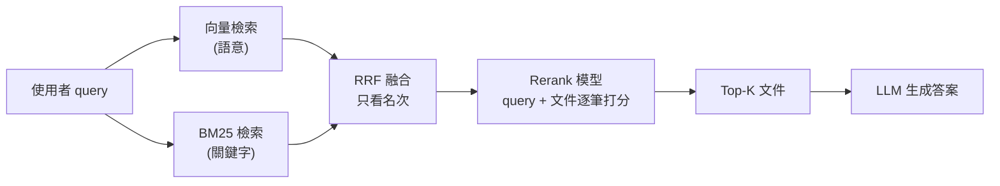
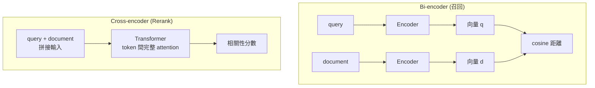

# RRF 與 Rerank 的差異：結果融合與重新排序

> 一句話版本：**RRF 是「合併多份排名」的演算法**，只看名次、不看內容、幾乎零成本；**Rerank 是「重新評分」的模型**，把 query 和每份候選文件一起讀過再打分，準確但昂貴。兩者解決的是不同問題，實務上常常串在一起用。

## Step 1：先搞清楚它們各自解決什麼問題

在 RAG 或搜尋系統裡，檢索通常分成兩個階段：

- **召回（Recall）**：從百萬級文件中快速撈出幾十到幾百筆候選。目標是「別漏掉」。
- **精排（Precision）**：從候選中挑出最相關的前幾筆餵給 LLM。目標是「排得準」。

RRF 與 Rerank 都發生在召回之後，但職責不同：

| 問題 | 解法 |
|------|------|
| 有多個檢索器（向量、BM25…），各自給一份排名，分數尺度不同，怎麼合併？ | **RRF**（Reciprocal Rank Fusion） |
| 召回的候選順序不夠準，bi-encoder 只看向量距離，怎麼排得更準？ | **Rerank**（通常是 cross-encoder） |

## Step 2：兩者在 pipeline 中的位置



RRF 在左邊處理「多路結果合併」，Rerank 在右邊處理「最終排序品質」。兩者不是二選一。

## Step 3：RRF 的運作原理

### 為什麼不直接把分數加起來？

向量檢索的 cosine similarity 落在 0 到 1，BM25 分數可能是 0 到 30 以上，兩者尺度、分佈完全不同，直接加權相加需要先做 normalization，而且很不穩定。

RRF 的做法是**完全丟掉分數，只用名次**：

$$
\text{RRF}(d) = \sum_{r \in R} \frac{1}{k + \text{rank}_r(d)}
$$

- $R$：所有檢索器的排名清單
- $\text{rank}_r(d)$：文件 $d$ 在第 $r$ 份清單中的名次（從 1 開始）
- $k$：平滑常數，慣例用 60；$k$ 越大，名次差異的影響越平緩

沒出現在某份清單中的文件，該項視為 0。

### 手算範例

假設 $k = 60$，兩個檢索器各回傳一份清單：

| 文件 | 向量檢索名次 | BM25 名次 | RRF 分數 |
|------|------------|-----------|----------|
| A | 1 | 3 | 1/61 + 1/63 ≈ 0.03227 |
| B | 2 | 1 | 1/62 + 1/61 ≈ 0.03252 |
| C | 3 | 未出現 | 1/63 ≈ 0.01587 |
| D | 未出現 | 2 | 1/62 ≈ 0.01613 |

最終順序：**B、A、D、C**。B 雖然在向量檢索只排第 2，但兩邊都排得前面，所以勝出；「多個檢索器都認同」的文件會被推高，這就是 RRF 的核心直覺。

### RRF 的特性

- **不需要訓練、不需要 GPU**，一個迴圈就能算完，延遲幾乎可忽略。
- **不需要分數校準**，不同來源的分數尺度不重要。
- **看不到內容**：它不知道文件到底有沒有回答到 query，只是在做名次的民主投票。
- 主流系統已內建：Elasticsearch、OpenSearch、MongoDB 的 `$rankFusion`、Qdrant、Weaviate 等。

## Step 4：Rerank 的運作原理

### Bi-encoder 與 cross-encoder

召回階段用的 embedding 模型是 **bi-encoder**：query 和文件**各自獨立**編碼成向量，再比距離。文件向量可以預先算好、建索引，所以快，但 query 與文件之間沒有任何 token 層級的互動。

Rerank 通常用 **cross-encoder**：把 query 和文件**拼在一起**丟進同一個 Transformer，讓 attention 在兩者之間互相看，最後輸出一個相關性分數。



代價是：文件向量**無法預先計算**，每次 query 都要對每一筆候選跑一次完整的模型 forward pass。所以 Rerank 只能用在「幾十到幾百筆」的候選上，不可能掃全庫。

### 常見的 Rerank 選擇

| 類型 | 例子 | 特性 |
|------|------|------|
| 託管 API | Cohere Rerank、Voyage Rerank、Jina Reranker | 開箱即用，按次計費，多語言支援佳 |
| 開源 cross-encoder | BGE Reranker、`ms-marco` 系列 cross-encoder | 可自架，需要 GPU 或接受較高 CPU 延遲 |
| LLM 當 reranker | 讓 LLM 對候選逐筆打分或做 listwise 排序 | 最靈活、最貴、最慢，可附帶理由 |

### 簡單範例

```python
from sentence_transformers import CrossEncoder

reranker = CrossEncoder("BAAI/bge-reranker-base")

query = "什麼是 KV cache?"
candidates = ["文件 1 的內容", "文件 2 的內容", "文件 3 的內容"]

# 每個 (query, doc) 配對各自跑一次模型，得到相關性分數
scores = reranker.predict([(query, doc) for doc in candidates])

ranked = [doc for _, doc in sorted(zip(scores, candidates), reverse=True)]
```

## Step 5：並排比較

| 面向 | RRF | Rerank |
|------|-----|--------|
| 本質 | 排名融合演算法 | 相關性評分模型 |
| 輸入 | 多份已排序的清單（只用名次） | query 加上每一筆候選文件的全文 |
| 是否理解語意 | 否 | 是（cross-encoder 看得到 query 與文件的互動） |
| 需要模型 | 不需要 | 需要 |
| 延遲 | 微秒到毫秒級 | 數十到數百毫秒，隨候選數線性成長 |
| 成本 | 幾乎為零 | 每次 query 都有推論成本或 API 費用 |
| 輸入來源數量 | 多路（兩路以上才有意義） | 單一候選清單即可 |
| 主要收益 | 融合異質檢索器、提升召回的穩健性 | 提升前幾名的精準度（precision） |
| 可調參數 | $k$ | 候選數量、模型選擇、截斷的 Top-K |
| 失敗模式 | 兩邊都排錯就一起錯；不會修正錯誤 | 候選裡沒有正解就救不回來；長文件被截斷 |

## Step 6：實務上怎麼組合

最常見也最推薦的組合是「**多路召回 → RRF → Rerank → Top-K**」：

1. 向量檢索與 BM25 各取 Top 50，用 RRF 合併成約 50 到 100 筆候選。RRF 讓關鍵字精準匹配（型號、錯誤碼、專有名詞）和語意相近的文件都有機會進入候選。
2. 把候選送進 Rerank，取前 5 到 10 筆。Rerank 修正 RRF 看不到內容所造成的排序誤差。
3. 前幾筆文件放進 prompt 交給 LLM。

怎麼選擇：

- **只有單一檢索器**：RRF 沒有用武之地，直接考慮 Rerank。
- **有多路召回、預算極度吃緊或延遲敏感**：只用 RRF 就能拿到大部分好處。
- **品質優先**（客服問答、法規、醫療等答錯成本高的場景）：RRF 加 Rerank。
- **候選數**：Rerank 的延遲與成本跟候選數成正比，通常 20 到 100 筆是甜蜜點，再多邊際效益遞減。

## Step 7：常見誤解

- **「RRF 是一種 reranking」**：名字裡有 rank，但 RRF 不評估相關性，只是把名次合併。有些文章把它歸為 rerank 的一種，嚴格說它是 fusion。
- **「有 Rerank 就不需要 hybrid search」**：Rerank 只能重排已經被召回的文件。如果向量檢索沒撈到那份含有精確關鍵字的文件，Rerank 再強也沒用；hybrid search 的目的是擴大召回的覆蓋面。
- **「Rerank 分數可以跨 query 比較」**：多數 reranker 的分數只在同一次 query 的候選之間有意義，拿來設全域門檻時要小心校準。
- **「候選越多越好」**：候選太多會讓延遲飆高，而且 cross-encoder 對長文件有長度上限，超過會被截斷。

## 相關筆記

- [RAG（Retrieval-Augmented Generation）的核心概念與運作原理](#/llm/04-applications/what-is-rag.mdx)
- [向量搜尋的原理，以及 MongoDB 與 AlloyDB 的 Hybrid Search 比較](#/swe/03-data-storage/what-is-vector-search-and-mongodb-hybrid-search.mdx)
- [Embedding Model 的選型考量與評估方法](#/llm/04-applications/how-to-choose-embedding-model.mdx)
