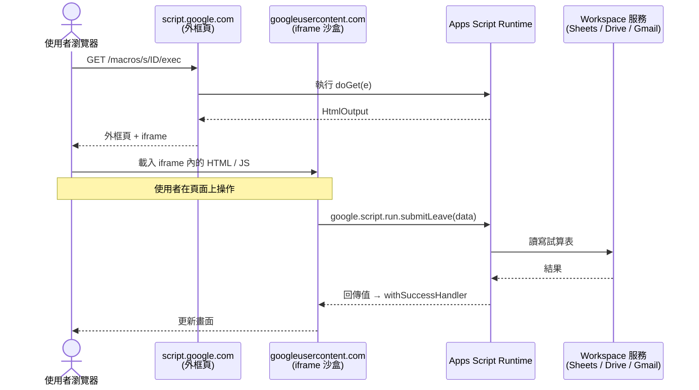

# Google Apps Script Web App 的運作方式、應用場景與限制

> 一句話版本：只要在 Apps Script 專案裡實作 `doGet(e)` / `doPost(e)` 並「部署為網頁應用程式」，Google 就會給你一個固定 URL，用 `HtmlService` 回傳網頁、用 `ContentService` 回傳 JSON，前端再透過 `google.script.run` 呼叫伺服器端函式；代價是網頁跑在 Google 的 iframe 沙盒裡、無法自訂網域與 HTTP 細節，並受 Apps Script 的執行時間與並發 quota 限制。

## Step 1：Web App 的本質——兩個保留函式 + 一次部署

Apps Script 的 Web App 沒有 router、沒有 server 設定檔，規則只有兩條：

| 收到的請求 | 呼叫的函式 | 回傳什麼 |
|------------|-----------|----------|
| HTTP GET | `doGet(e)` | `HtmlService` 產生的網頁，或 `ContentService` 產生的文字 / JSON |
| HTTP POST | `doPost(e)` | 同上 |

參數 `e` 是事件物件，常用欄位：

| 欄位 | 內容 |
|------|------|
| `e.parameter` | query string 參數（每個 key 取第一個值） |
| `e.parameters` | query string 參數（每個 key 是陣列） |
| `e.pathInfo` | URL 中 `/exec` 之後的路徑 |
| `e.postData.contents` | POST body 原文 |
| `e.postData.type` | POST 的 Content-Type |

部署後會得到兩種 URL：

| URL 結尾 | 指向 | 誰能用 |
|----------|------|--------|
| `.../macros/s/部署ID/exec` | 某個**固定版本**的部署 | 依部署設定開放給使用者 |
| `.../macros/s/腳本ID/dev` | **最新儲存的程式碼**（head） | 只有對專案有編輯權的人，用來測試 |

## Step 2：運作架構——網頁跑在 iframe 沙盒裡

使用者打開 `/exec` 網址時，實際看到的頁面是 Google 外框頁內嵌的一個 iframe，iframe 內容來自 `*.googleusercontent.com` 網域。這個設計是為了隔離使用者寫的 HTML / JS，避免它存取 `script.google.com` 的 cookie。



理解這張圖就能理解大部分限制：每一次 `google.script.run` 都是**一次完整的伺服器端執行**（受 6 分鐘上限與並發 quota 約束），而所有前端程式都被關在 iframe 裡。

## Step 3：最小可用範例——請假申請表單

一個典型的「網頁表單 → 寫進試算表」專案，檔案結構如下：

```text
Code.gs        # 伺服器端：doGet、業務函式
Index.html     # 頁面骨架
Stylesheet.html
JavaScript.html
```

### 伺服器端 `Code.gs`

```javascript
const SHEET_ID = 'SHEET_ID';

function doGet(e) {
  const tpl = HtmlService.createTemplateFromFile('Index');
  tpl.userEmail = Session.getActiveUser().getEmail();  // 依部署設定可能為空字串
  return tpl.evaluate()
    .setTitle('請假申請')
    .addMetaTag('viewport', 'width=device-width, initial-scale=1');
}

/** 在模板中引入其他 HTML 檔（拆分 CSS / JS） */
function include(filename) {
  return HtmlService.createHtmlOutputFromFile(filename).getContent();
}

/** 前端透過 google.script.run 呼叫；回傳值會傳回前端 */
function submitLeave(form) {
  if (!form.name || !form.startDate || !form.days) {
    throw new Error('欄位不完整');  // 前端的 withFailureHandler 會收到
  }
  const lock = LockService.getScriptLock();
  lock.waitLock(10 * 1000);
  try {
    const sheet = SpreadsheetApp.openById(SHEET_ID).getSheetByName('請假');
    const id = Utilities.getUuid();
    sheet.appendRow([id, new Date(), form.name, form.startDate, Number(form.days), '待審核']);
    return { ok: true, id };
  } finally {
    lock.releaseLock();
  }
}
```

### 前端 `Index.html`

```html
<!DOCTYPE html>
<html>
  <head>
    <base target="_top">
    <?!= include('Stylesheet'); ?>
  </head>
  <body>
    <h1>請假申請</h1>
    <p>登入身分：<?= userEmail || '未知' ?></p>
    <form id="leave-form">
      <input name="name" placeholder="姓名" required>
      <input name="startDate" type="date" required>
      <input name="days" type="number" min="0.5" step="0.5" required>
      <button type="submit">送出</button>
    </form>
    <div id="result"></div>
    <?!= include('JavaScript'); ?>
  </body>
</html>
```

### 前端 `JavaScript.html`

```html
<script>
  document.getElementById('leave-form').addEventListener('submit', (ev) => {
    ev.preventDefault();
    const data = Object.fromEntries(new FormData(ev.target));
    google.script.run
      .withSuccessHandler((res) => {
        document.getElementById('result').textContent = '已送出，單號 ' + res.id;
      })
      .withFailureHandler((err) => {
        document.getElementById('result').textContent = '失敗：' + err.message;
      })
      .submitLeave(data);
  });
</script>
```

幾個重點：

- **模板語法（scriptlet）**：`<?= ?>` 會做 HTML escape 後輸出，`<?!= ?>` 原樣輸出（只用在 `include` 這種可信內容），`<? ?>` 執行程式但不輸出。
- **`google.script.run` 是非同步的**：沒有回傳 Promise，要用 `withSuccessHandler` / `withFailureHandler` 接結果；需要 async/await 時自己包一層 Promise。
- **可傳遞的型別有限**：參數與回傳值只能是基本型別、陣列、純物件（以及 form 元素）；`Date`、函式、DOM 節點都不行，日期要先轉成字串或 timestamp。

## Step 4：部署設定——「以誰的身分執行」×「誰可以存取」

部署 Web App 時要選兩個設定，組合起來決定了這個網頁的安全模型：

**執行身分（Execute as）**

| 選項 | 意義 |
|------|------|
| **我（Me）** | 所有請求都以部署者的權限執行；訪客不需要授權，但能透過你的程式碼間接存取你的資料 |
| **存取網頁應用程式的使用者（User accessing）** | 以每位訪客自己的權限執行；訪客必須登入 Google 帳號並同意授權畫面 |

**存取權限（Who has access）**

| 選項 | 意義 |
|------|------|
| 只有我自己 | 開發測試用 |
| 網域內的任何人 | 只有同一個 Workspace 組織的帳號能開 |
| 任何擁有 Google 帳號的使用者 | 必須登入，但不限組織 |
| 任何人 | 不需登入，公開網址 |

常見組合與用途：

| 組合 | 適用情境 | 風險 |
|------|----------|------|
| 我 + 網域內任何人 | 公司內部工具（請假、報修、查詢儀表板） | 低；記得用 `Session.getActiveUser()` 做權限判斷 |
| 使用者本人 + 網域內任何人 | 要操作「使用者自己的」Gmail / Drive 的工具 | 低；每位使用者要各自授權 |
| 我 + 任何人 | 公開表單、webhook 接收端、公開 JSON API | **高**：等於把你的權限開放到網際網路上 |

`Session.getActiveUser().getEmail()` 不一定拿得到訪客 email：只有在「以使用者本人執行」，或部署者與訪客屬於同一個 Workspace 網域時才會有值，其他情況回傳空字串，不能拿來當公開網頁的身分驗證。

## Step 5：可以做到哪些事情

| 類型 | 做法 | 範例 |
|------|------|------|
| **內部表單與流程** | `HtmlService` 頁面 + `google.script.run` 寫入 Sheets | 請假、採購申請、設備借用，搭配 `MailApp` 寄審核信 |
| **資料儀表板** | 伺服器端讀 Sheets / BigQuery，前端用 Chart.js、Google Charts 畫圖 | 業績看板、工單統計 |
| **簡易 SPA** | 透過 CDN 載入 Vue / React / Alpine.js，用 `google.script.history` 管理 hash 路由 | 多頁籤的管理後台 |
| **檔案上傳** | 前端讀檔轉 base64，伺服器端用 `DriveApp.createFile()` 存進 Drive | 收集報名附件、收據 |
| **JSON API** | `doGet` / `doPost` 回傳 `ContentService` 的 JSON | 讓其他系統查詢試算表資料 |
| **Webhook 接收端** | `doPost` 解析 body，寫入 Sheets 或轉發到 Slack | 接 GitHub、表單服務、監控系統的通知 |
| **嵌入其他頁面** | 嵌入 Google Sites；或設定 `setXFrameOptionsMode(ALLOWALL)` 後嵌進自己的網站 | 在內部 wiki 放一個查詢小工具 |

### JSON API 範例

```javascript
function doGet(e) {
  const rows = SpreadsheetApp.openById(SHEET_ID).getSheetByName('產品').getDataRange().getValues();
  const [header, ...data] = rows;
  const items = data.map(r => Object.fromEntries(header.map((h, i) => [h, r[i]])));
  return ContentService.createTextOutput(JSON.stringify({ items }))
    .setMimeType(ContentService.MimeType.JSON);
}

function doPost(e) {
  const body = JSON.parse(e.postData.contents);
  if (body.token !== PropertiesService.getScriptProperties().getProperty('API_TOKEN')) {
    return ContentService.createTextOutput(JSON.stringify({ ok: false, error: 'unauthorized' }))
      .setMimeType(ContentService.MimeType.JSON);  // 無法回 401，只能在 body 表示錯誤
  }
  // ...處理資料
  return ContentService.createTextOutput(JSON.stringify({ ok: true }))
    .setMimeType(ContentService.MimeType.JSON);
}
```

從外部呼叫時要注意兩點：

```bash
# ContentService 的回應會先 302 redirect 到 googleusercontent.com，curl 要加 -L 跟隨轉址
curl -L "https://script.google.com/macros/s/DEPLOYMENT_ID/exec"

# POST 也一樣；轉址後 curl 會改用 GET 取回結果，這是預期行為
curl -L -H "Content-Type: text/plain" \
  -d '{"token":"xxx","event":"deploy"}' \
  "https://script.google.com/macros/s/DEPLOYMENT_ID/exec"
```

在**其他網站的瀏覽器端**用 `fetch` 呼叫時，Content-Type 若設為 `application/json` 會觸發 CORS preflight（`OPTIONS` 請求），而 Apps Script 不處理 `OPTIONS`，請求會失敗。常見繞法是以 `text/plain` 送出 JSON 字串，伺服器端照樣用 `JSON.parse` 解析。

## Step 6：限制總整理

### HTTP 層面的限制

| 限制 | 影響 |
|------|------|
| 只支援 GET 與 POST | 無法設計 `PUT` / `PATCH` / `DELETE` 的 RESTful API，只能用參數區分動作 |
| 讀不到 request header | 無法用 `Authorization` header 做驗證，token 只能放在 query string 或 body |
| 無法設定 status code 與 response header | 錯誤只能寫在 body 裡；無法自訂 CORS、cache 相關 header |
| `ContentService` 回應經過 302 轉址 | 呼叫端必須跟隨轉址；部分 webhook 發送方不跟隨轉址，或會把轉址視為失敗 |
| 不支援 WebSocket / SSE | 沒有即時推送，只能輪詢 |

### 前端與呈現的限制

| 限制 | 影響 |
|------|------|
| 網頁跑在 `googleusercontent.com` 的 iframe 沙盒中 | 無法存取外層頁面；部分瀏覽器 API、第三方 cookie 與儲存會受限 |
| 網址固定為 `script.google.com/macros/s/...` | 無法綁自訂網域，只能用短網址或嵌入其他網站間接處理 |
| 非同網域的訪客會看到 Google 的提示橫幅 | 提示「此應用程式由 Google Apps Script 使用者建立」，對外服務顯得不正式 |
| 沒有靜態檔案託管 | CSS / JS 要寫在 HTML 檔裡，圖片要用外部網址或 base64 |
| 瀏覽器登入多個 Google 帳號時 | 常見授權錯誤或 `google.script.run` 失敗，需請使用者用無痕視窗或單一帳號 |
| 對 SEO 不友善 | 內容在 iframe 中且多為動態載入，不適合需要被搜尋引擎收錄的網站 |

### 執行與容量的限制

| 限制 | 影響 |
|------|------|
| 每次請求、每次 `google.script.run` 都是一次獨立執行 | 有冷啟動延遲，一次呼叫常見數百毫秒到數秒，不適合高互動頻率的 UI |
| 單次執行上限 6 分鐘 | 重運算或大量資料要拆成多次呼叫 |
| 同時執行數上限（每位使用者約 30） | 「以我身分執行」時，**所有訪客的執行都算在部署者頭上**，尖峰時會出現 quota 錯誤 |
| 每日 quota 也算在執行身分上 | 公開 Web App 寄信、`UrlFetchApp` 次數會很快消耗部署者的額度 |
| 沒有 SLA | 不能承諾可用性，Google 端服務異常時無法處理 |

把同時執行數上限換成可承受的流量，可以用 Little's Law 粗估。若同時執行上限為 $L$，平均每次執行耗時為 $W$ 秒，能穩定承受的請求速率約為：

$$
\lambda_{max} \approx \frac{L}{W} = \frac{30}{1.5\ \text{s}} = 20\ \text{req/s}
$$

而且這是理想值；實務上試算表寫入還要排隊拿 `LockService` 的鎖，實際吞吐量會更低。**Apps Script Web App 是為「數十人的內部工具」設計的，不是為公開網站設計的。**

### 部署管理的陷阱

- **「新增部署」會產生新的 URL**；要維持網址不變，應該用「管理部署 → 編輯 → 選新版本」。
- 改完程式碼沒有重新部署，`/exec` 仍跑舊版本，常被誤以為「改了沒生效」；測試請用 `/dev`。

## Step 7：安全性檢查清單

1. **最小開放範圍**：能選「網域內」就不要選「任何人」。
2. **「我 + 任何人」等於公開 API**：所有輸入都要驗證，用 Script Properties 存 shared secret 並在 body 或 query 驗證 token（header 讀不到）。
3. **在伺服器端做授權判斷**：前端隱藏按鈕不算權限控管，`google.script.run` 可以被任何訪客從 DevTools 直接呼叫任意**非私有**函式。
4. **隱藏內部函式**：函式名稱以底線結尾（如 `writeAudit_()`）會變成私有函式，前端無法呼叫。
5. **防 XSS**：輸出使用者資料用 `<?= ?>`（會 escape），不要用 `<?!= ?>`；前端用 `textContent` 而不是 `innerHTML`。
6. **資料權限隔離**：「以我身分執行」時，訪客能讀到的就是你的程式碼願意回傳的資料，不要把整份敏感試算表直接回傳給前端再過濾。

## Step 8：什麼時候該換掉 Apps Script Web App

| 需求 | Apps Script Web App | 建議替代方案 |
|------|--------------------|--------------|
| 組織內部、數十人使用的表單與工具 | ✅ 最快、免費、免維運 | — |
| 需要自訂網域、品牌化的對外網站 | ❌ | Firebase Hosting、Cloud Run |
| 正式的 REST API（status code、header、驗證） | ❌ | Cloud Run、Cloud Functions + API Gateway |
| 高流量、需要 SLA | ❌ | Cloud Run（可水平擴展） |
| 即時互動（聊天、協作編輯） | ❌ | Cloud Run + WebSocket、Firestore realtime |
| 只要表單，不需要自訂邏輯 | ⚠️ 殺雞用牛刀 | Google Forms、AppSheet |

一個務實的演進路徑是：先用 Apps Script Web App 快速驗證需求；當使用者數、流量或安全需求超過它的能力邊界時，把伺服器端邏輯搬到 Cloud Run，Sheets 只保留作為資料來源或改用正式資料庫。

## 相關筆記

- [Google Apps Script 的核心概念與運作原理](#/sre/05-gcp/google-apps-script-overview.mdx)
- [GCP Cloud Run 的原理與應用](#/sre/05-gcp/gcp-cloud-run-overview.mdx)
- [GCP Pub/Sub Push 訂閱與 Cloud Tasks 的核心差異](#/sre/05-gcp/pubsub-push-vs-cloud-tasks.mdx)
