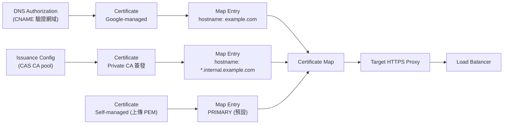
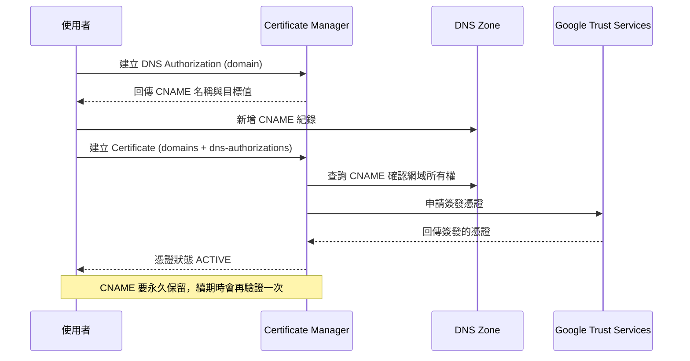

# GCP Certificate Manager 的核心概念與功能

> 一句話版本：Certificate Manager 是 GCP 上集中「申請、部署、輪替」TLS 憑證的受管服務。它能自動簽發並續期 Google-managed 憑證，也能託管自己上傳的憑證或由 Private CA 簽發的憑證，再透過 certificate map 依 hostname（SNI）掛到 Load Balancer 上，適合大量網域或需要在切流量前先備妥憑證的場景。

## Step 1：它解決什麼問題

HTTPS 服務需要 TLS 憑證，傳統做法有三個痛點：

1. **憑證會過期**：手動申請的憑證通常 90 天到 1 年到期，忘記換就是事故。
2. **綁在 Load Balancer 上**：舊式做法是把憑證直接掛在 target HTTPS proxy，憑證數量與可用網域有限，換憑證也要動 LB 設定。
3. **切換流量前無法先拿到憑證**：Google-managed 憑證傳統上要等網域 DNS 已指向 LB 才能通過驗證，遷移時會有一段「憑證還沒好」的空窗（見 [GKE 跨叢集遷移時 Ingress 外部 IP 切換的風險與正確做法](#/sre/03-operations/gke-cluster-migration-ingress-cutover.mdx)）。

Certificate Manager 把「憑證的生命週期」與「憑證掛在哪裡」拆開管理，並提供 DNS authorization 讓你不依賴 LB 就能先完成網域驗證。

## Step 2：核心資源與關係

| 資源 | 用途 |
|------|------|
| Certificate | 一張憑證，可以是 Google-managed、self-managed 或 Private CA 簽發 |
| DNS Authorization | 用 DNS CNAME 證明你擁有網域，供 Google-managed 憑證申請使用 |
| Certificate Issuance Config | 指定由哪個 Certificate Authority Service（CAS）的 CA pool 簽發憑證 |
| Certificate Map | 一組「hostname → 憑證」的對照表，掛在 target proxy 上 |
| Certificate Map Entry | map 裡的一筆規則，比對 hostname（可為萬用字元）或 PRIMARY（預設） |
| Trust Config | mTLS 時用來驗證 client 憑證的信任錨（root / intermediate CA） |



重點：**憑證與 map 解耦**。換憑證只需改 map entry 的指向，不必動 LB 本身；同一張憑證也可被多個 map entry 重複使用。

## Step 3：三種憑證類型

### Google-managed 憑證

- 由 Google Trust Services 簽發的公開信任 DV（Domain Validated）憑證。
- Google 自動續期，不需人工介入；到期前會提早重新驗證並換發。
- 支援多個網域（SAN）與**萬用字元網域**（萬用字元必須使用 DNS authorization）。
- 若網域設有 CAA record，必須允許 `pki.goog` 簽發，否則申請會失敗。

### Self-managed 憑證

- 自己向任意 CA 申請後，以 PEM 格式（憑證鏈與私鑰）上傳。
- 適合已有既定 CA 流程、需要 EV/OV 憑證、或必須使用特定 CA 的情境。
- **續期要自己負責**，Certificate Manager 只負責儲存與部署，不會幫你換新。

### Private CA 簽發的 Google-managed 憑證

- 透過 Certificate Issuance Config 指向 CAS 的 CA pool，由你自己的私有 CA 簽發。
- 適合內部服務（只有公司內部 client 信任你的 root CA），仍可享有自動續期。

## Step 4：兩種網域驗證方式

Google-managed 憑證要先證明你擁有網域，有兩種做法：

| 項目 | Load Balancer authorization | DNS authorization |
|------|----------------------------|-------------------|
| 驗證依據 | 網域 DNS 已指向該 LB 的 IP | 在 DNS 加一筆 `_acme-challenge_...` CNAME |
| 能否先備憑證 | 不行，必須等流量已導到 LB | **可以**，不需要 LB 也不需要流量 |
| 萬用字元 | 不支援 | 支援 |
| 適用 | 簡單的單一網域場景 | 遷移、零停機切換、萬用字元、大量網域 |

DNS authorization 的時序：



## Step 5：Certificate Map 與 SNI

一個 LB 往往要服務多個網域。Certificate map 的運作方式：

1. client 在 TLS handshake 帶上 SNI（想連的 hostname）。
2. LB 到 certificate map 找比對的 entry：**精確 hostname 優先於萬用字元**。
3. 都沒比對到時，使用標記為 `PRIMARY` 的 entry 當預設憑證。

這讓 SaaS 類產品（每個客戶一個自訂網域）可以用同一個 LB 管理大量憑證，而不是被傳統「單一 proxy 最多掛幾張憑證」的上限卡住。實際數量上限以官方 quota 為準。

## Step 6：實作範例（gcloud）

```bash
# 1. 建立 DNS authorization，取得要加的 CNAME
gcloud certificate-manager dns-authorizations create example-auth \
  --domain="example.com"
gcloud certificate-manager dns-authorizations describe example-auth

# 2. 在 DNS 加上輸出的 CNAME 後，建立 Google-managed 憑證（含萬用字元）
gcloud certificate-manager certificates create example-cert \
  --domains="example.com,*.example.com" \
  --dns-authorizations="example-auth"

# 3. 建立 map 與 entry
gcloud certificate-manager maps create example-map
gcloud certificate-manager maps entries create example-entry \
  --map="example-map" \
  --hostname="example.com" \
  --certificates="example-cert"

# 4. 把 map 掛到 target HTTPS proxy
gcloud compute target-https-proxies update my-https-proxy \
  --certificate-map="example-map"
```

Terraform 對應的資源是 `google_certificate_manager_dns_authorization`、`google_certificate_manager_certificate`、`google_certificate_manager_certificate_map` 與 `google_certificate_manager_certificate_map_entry`。

## Step 7：其他功能

- **mTLS 的 Trust Config**：LB 要求 client 出示憑證時，用 Trust Config 定義信任的 CA，搭配 ServerTlsPolicy 啟用。
- **可觀測性**：憑證狀態（PROVISIONING / ACTIVE / FAILED）、到期時間可透過 Cloud Monitoring 指標與 Cloud Logging 觀察，建議對「即將到期」與「簽發失敗」設告警。
- **與 GKE 整合**：GKE Gateway 可透過 annotation 參照 certificate map，取代舊的 `ManagedCertificate` CRD。
- **IAM 與稽核**：憑證、map 都是 project 內的資源，可用 IAM 控管誰能建立與綁定，操作紀錄進入 Cloud Audit Logs。

## Step 8：常見的簽發失敗原因

| 症狀 | 常見原因 |
|------|----------|
| 長時間停在 PROVISIONING | DNS CNAME 未生效、填錯值，或 DNS 還沒傳播 |
| AUTHORIZATION_ISSUES | CNAME 不存在、被刪除，或 CAA record 未允許 `pki.goog` |
| RATE_LIMITED | 短時間內申請次數過多，觸發 CA 的頻率限制 |
| 用 LB authorization 失敗 | 網域尚未指向 LB，或 LB 沒有 HTTPS forwarding rule |

## Step 9：與其他憑證機制的比較

| 機制 | 定位 |
|------|------|
| 傳統 Compute Engine SSL certificate | 憑證直接綁在 target proxy，數量與彈性有限，屬舊式做法 |
| GKE `ManagedCertificate` | 專為 GKE Ingress 設計，不支援萬用字元，也不能事先驗證 |
| Certificate Manager | 新一代做法：支援萬用字元、DNS authorization、大規模與 Private CA |
| Cloud Run domain mapping | Cloud Run 自行處理憑證，與 Certificate Manager 無關 |

新專案若使用外部 Application Load Balancer，建議直接採用 Certificate Manager。

## Step 10：Certificate Map 與 Gateway 的綁定數量

Certificate map 是獨立資源，本身不記錄誰在使用它；綁定關係寫在使用方（target proxy，或 GKE Gateway 的 annotation）。因此兩個方向的基數不同：

| 方向 | 可否 | 說明 |
|------|------|------|
| 一個 map 掛到多個 Gateway / target proxy | 可以 | 1 對多，多個 Gateway 的 annotation 可指向同一個 map |
| 一個 Gateway / target proxy 掛多個 map | 不行 | 只能參照一個 map，annotation 或 `--certificate-map` 只接受單一值 |

```yaml
apiVersion: gateway.networking.k8s.io/v1
kind: Gateway
metadata:
  name: gw-a
  annotations:
    networking.gke.io/certmap: prod-cert-map   # 只能寫一個 map 名稱
spec:
  gatewayClassName: gke-l7-global-external-managed
  listeners:
  - name: https
    protocol: HTTPS
    port: 443
```

### 為什麼設計成單一 map

Map 本身已經是「hostname → 憑證」的多對多對照表。一個 Gateway 需要服務多個網域時，做法是在同一個 map 裡加多個 entry，而不是掛多個 map。多個 map 還會讓 SNI 比對出現優先順序與衝突問題，所以平台直接限制為一個。

### 需要多個 map 的內容時怎麼辦

| 需求 | 做法 |
|------|------|
| 一個 Gateway 要服務多組網域 | 把所有 entry 合併進同一個 map |
| 不同團隊或不同環境的憑證要隔離 | 各自建 map，各自掛在不同 Gateway |
| 兩個 Gateway 要共用同一批網域 | 共用同一個 map，憑證只維護一份 |

### 共用 map 的注意事項

1. **Scope 要對得上**：global external Application Load Balancer 用 global map；regional LB 要用同 region 的 regional map。
2. **同時影響所有使用方**：增刪 entry 或更換憑證，所有引用該 map 的 Gateway 會一起生效，blast radius 變大。prod 與 staging 不要共用。
3. **與其他憑證設定互斥**：同一個 target proxy 若已設定 certificate map，就不要再混用傳統的 SSL certificates；GKE 上也請避免在同一個 Gateway 混用其他憑證來源。細節以官方文件為準。
4. **PRIMARY entry 也是共用的**：沒有比對到 SNI 時的 fallback 憑證，所有使用方都會用到同一張。

### 驗證指令

```bash
# map 內有哪些 entry
gcloud certificate-manager maps entries list --map=prod-cert-map

# 哪些 target proxy 引用了這個 map
gcloud compute target-https-proxies list \
  --format="table(name,certificateMap)"

# Gateway 的 annotation
kubectl get gateway -A -o yaml | grep -B2 -A2 certmap
```

## 重點整理

1. Certificate Manager 管理憑證的**生命週期**（申請、驗證、續期），certificate map 管理憑證**掛在哪裡**。
2. 三種憑證：Google-managed、self-managed、Private CA 簽發；只有前者與 Private CA 簽發的會自動續期。
3. **DNS authorization** 是關鍵：可事先取得憑證、支援萬用字元，因此是零停機遷移的首選。
4. 要記得保留 CNAME、檢查 CAA record，並為憑證到期與簽發失敗設監控。
5. 一個 certificate map 可以被多個 Gateway 共用，但一個 Gateway 只能參照一個 map；要服務多個網域就在 map 裡加 entry。

## 相關筆記

- [GKE 跨叢集遷移時 Ingress 外部 IP 切換的風險與正確做法](#/sre/03-operations/gke-cluster-migration-ingress-cutover.mdx)
- [GCP VPC Network 的架構與核心概念](#/sre/05-gcp/gcp-vpc-network.mdx)
- [Terraform 與 GCP 的整合：Infrastructure as Code 實踐](#/sre/05-gcp/terraform-gcp-overview.mdx)
