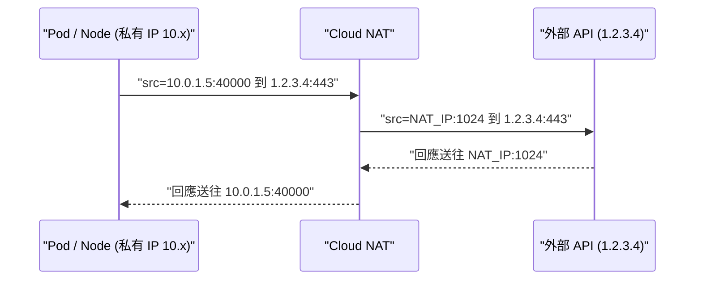

# GCP Cloud NAT 的運作原理與 GKE 對外出口 IP

> Cloud NAT 是 GCP 的託管式 NAT 服務，讓沒有外部 IP 的 VM、GKE node 與 Pod 能主動連到網際網路；外部看到的來源 IP，就是 Cloud NAT 所使用的外部 IP。它只處理 outbound，跟 Gateway / Load Balancer 綁定的 inbound IP 是兩件獨立的事。

## Step 1：Cloud NAT 是什麼

Cloud NAT 是 GCP 的託管式 NAT 服務，讓**沒有外部 IP 的 VM、GKE node 或 Pod** 可以主動連到網際網路，而網際網路上的主機不能主動連進來。

- 它是軟體定義的服務（Andromeda SDN），不是一台 NAT gateway VM，沒有單點故障或頻寬瓶頸。
- 它掛在 **Cloud Router** 上設定，作用範圍是「某個 VPC、某個 region 的某些 subnet」。
- 只處理 **outbound 發起的連線**及其回程封包，不支援 inbound 主動連入。

## Step 2：運作流程

NAT 把來源的「私有 IP:port」換成「NAT 外部 IP:port」，並記錄對應表，回程封包再反向轉換。

## Step 3：外部看到的 IP 從哪來

這取決於 NAT IP 的配置方式：

| 模式 | 說明 | 適用情境 |
|------|------|----------|
| Auto-allocate | GCP 自動配 IP，IP 可能隨規模變動 | 不需要 IP 白名單 |
| Manual | 預先保留 static external IP 並指定給 NAT | 對方要求 IP 白名單時必用 |

所以如果 GKE 要呼叫需要白名單的第三方 API，做法是用 **manual 模式 + 保留的 static IP**，再把這些 IP 提供給對方。

## Step 4：GKE 情境的重點

1. **適用於 private cluster**：node 沒有外部 IP，對外流量（拉 image、呼叫外部 API）必須靠 Cloud NAT。
2. **Pod IP 也要涵蓋**：GKE 是 VPC-native，Pod 使用 subnet 的 secondary range。Cloud NAT 設定時要選擇包含 primary range 與 secondary range（例如 "All IP ranges of all subnets"），否則 Pod 對外會不通。
3. **只影響到外部的流量**：Pod 連 Google API（Artifact Registry、GCS 等）若開了 Private Google Access，走 Google 內部網路，不經 Cloud NAT。
4. **同 region 共用**：一個 region 內多個 cluster / VM 共用同一組 NAT IP，外部分不出是哪個 workload。

## Step 5：常見的坑

- **Port 耗盡（`OUT_OF_RESOURCES`）**：每個 NAT IP 約有 64k 個 port（實際可用約 64,512）。每個 VM 預設至少分配 64 個 port（可調）。Pod 密度高、連線多的 node 會用光，導致對外連線失敗或被 drop。對策：增加 NAT IP、調高 `min ports per VM`、開啟 Dynamic Port Allocation、重用連線。
- **Endpoint-Independent Mapping**：開啟時，同一來源 IP:port 連不同目的地會共用同一個 NAT 對映，會影響 port 的重用效率，視需求調整。
- **TCP time-wait 逾時**：連線關閉後 port 會保留一段時間才釋放，短連線多時會加劇 port 耗盡。
- **看 log 排錯**：開啟 Cloud NAT logging，可看到轉換紀錄與 drop 原因（例如 allocation failed）。

## Step 6：Cloud NAT IP 與 Gateway IP 的差別

常見的誤解是把 Cloud NAT 的 IP 跟 Gateway 綁定的 static IP 混為一談，兩者方向完全相反：

| | Gateway 綁定的 static IP | Cloud NAT 的 IP |
|---|---|---|
| 方向 | Inbound：外部用戶端連進來 | Outbound：Pod / Node 主動連出去 |
| 角色 | Load Balancer 的 frontend VIP（forwarding rule 的位址） | NAT 轉換後的來源位址 |
| 誰會看到 | 用戶端 DNS 解析到的 IP | 被呼叫的第三方 API 看到的來源 IP |
| 資源 | 保留的 external static IP，在 Gateway 的 `addresses` 指定 | 保留的 static IP，指定給 Cloud NAT gateway |

- **Gateway 的 IP 不會變成 Pod 對外呼叫的來源 IP**：Pod 主動連出去的流量不會經過 Load Balancer。
- **對方要求白名單我們的出口 IP 時，給 Cloud NAT 的 IP，不是 Gateway 的 IP。**
- **反過來，別人要白名單我們的服務時**（例如合作夥伴要連我們的 API），要加的是 Gateway 的 IP。
- 一個既對外提供服務、又要呼叫外部白名單 API 的 GKE cluster，通常同時有這兩個 IP，各管各的方向。

## 與相近做法的比較

| 做法 | 特性 |
|------|------|
| 外部 IP 直接掛在 VM 上 | 每台 VM 有自己的出口 IP，難以集中管理白名單，暴露面大 |
| Cloud NAT | 集中、固定的出口 IP，node 不暴露 |
| Load Balancer / Ingress / Gateway | 負責 inbound，Cloud NAT 不處理 |

## 小結給 SRE 視角

- Cloud NAT 是「私有資源主動對外時的 IP 轉換服務」，決定外部看到的出口 IP。
- 需要固定出口 IP 做白名單時，用 manual 模式搭配 static IP。
- 容量規劃要看 port：NAT IP 數量、每 VM 最少 port 數、Pod 密度與連線模式都會影響，並用 Cloud NAT logging 與監控及早發現 port 耗盡。

## 相關筆記

- [GCP VPC Network 的架構與核心概念](#/sre/05-gcp/gcp-vpc-network.mdx)
- [GKE Cluster 與 VM 之間的內網互通與資料傳輸費用](#/sre/05-gcp/gke-vm-same-vpc-network-cost.mdx)
- [GCP Certificate Manager 的核心概念與功能](#/sre/05-gcp/gcp-certificate-manager-overview.mdx)
