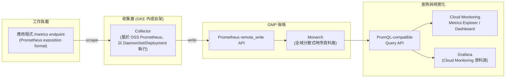

# Google Cloud Managed Service for Prometheus 的核心概念與架構

> 一句話：Managed Service for Prometheus（GMP）是 Google Cloud 全託管、與 PromQL / Prometheus 生態相容的指標儲存服務，用 Google 內部的全域時序資料庫 Monarch 取代自建 TSDB，免除容量規劃、Sharding、HA 的維運負擔。

## Step 1：為什麼需要 Managed Prometheus

自架 Prometheus 在小規模很好用，但規模一大會遇到幾個結構性問題：

- **單機 TSDB、本機磁碟**：Prometheus server 預設把資料寫在本機磁碟，retention 受磁碟容量限制，通常只留幾週。
- **高可用要疊 Thanos / Cortex / Mimir**：原生 Prometheus 是單體，要做 HA 或跨區查詢得自己疊一層 remote storage 方案，維運成本高。
- **高 cardinality 需要手動 sharding**：label 組合一多，單一 Prometheus instance 記憶體與查詢效能就會崩，得自己切 shard、做聯邦（federation）。

GMP 的做法是把「收集」與「儲存」拆開：收集端沿用 Prometheus 生態的 exporter／`/metrics` endpoint 與 PromQL 語法，儲存端則直接寫進 Monarch——Google 內部拿來撐 Google 自家服務監控的全域分散式時序資料庫，本來就設計成近乎無限 retention、跨區可查、不需要手動 shard。

## Step 2：架構總覽



收集端負責「怎麼把 metrics 抓出來」，這部分完全沿用 Prometheus 社群的 exporter 生態（node_exporter、各種 client library）；儲存與查詢端則完全由 Google 託管，使用者不需要碰 TSDB compaction、磁碟容量、shard 拓撲這些事。

## Step 3：兩種收集模式

GMP 提供兩種收集方式，差異在「誰來跑 collector」：

| 模式 | 說明 | 適用情境 |
|------|------|----------|
| Managed Collection | Google 在 GKE cluster 內以 DaemonSet 部署已調校好的 collector（基於 OSS Prometheus），透過 `PodMonitoring` / `ClusterPodMonitoring` CRD 設定 scrape target | 大多數 GKE workload，不想自己維運 collector |
| Self-Deployed Collection | 沿用既有的自架 Prometheus server（或任何相容 exporter），把它的 `remote_write` 指向 GMP endpoint | 已有現成 Prometheus 部署、非 GKE 環境（GCE、on-prem、其他雲）想接進 GMP |

Managed Collection 下的 scrape 設定範例（`PodMonitoring` 取代了 Prometheus Operator 慣用的 `ServiceMonitor`）：

```yaml
apiVersion: monitoring.googleapis.com/v1
kind: PodMonitoring
metadata:
  name: my-app-monitoring
spec:
  selector:
    matchLabels:
      app: my-app
  endpoints:
    - port: metrics
      interval: 30s
```

## Step 4：與 GKE 的整合

- GKE 1.25 之後，Managed Collection **預設啟用**（可透過 `--enable-managed-prometheus` / cluster 設定關閉）。
- 底層是一組 `gke-metrics-agent` DaemonSet，跑在每個 node 上做本機 scrape，再彙整送往 GMP 後端，職責上等同一個縮小版、自動調校過的 Prometheus server。
- 使用者只需要部署 `PodMonitoring`（namespace 範圍）或 `ClusterPodMonitoring`（cluster 範圍）CRD 指定 scrape target，不需要碰 collector 本身的部署與擴容。

## Step 5：查詢與視覺化

GMP 對外提供 **PromQL-compatible 查詢 endpoint**（`monitoring.googleapis.com` 下的 Prometheus API），所以既有工具鏈幾乎可以直接沿用：

- **Cloud Monitoring Metrics Explorer**：內建可切換用 PromQL 或 MQL 查詢，也能把 GMP 指標直接拉進既有的 Dashboard（見 [Cloud Monitoring Dashboard 與 Metrics Explorer 的關係](#/sre/05-gcp/gcp-monitoring-dashboard.mdx)）。
- **Grafana**：透過官方的 Cloud Monitoring / Managed Service for Prometheus 資料源外掛，既有的 Prometheus 風格 Dashboard 幾乎可以原樣搬過來。
- **`promtool` / gcloud**：GMP 相容標準 Prometheus HTTP API，社群工具鏈基本不用改。

這代表原本用 Prometheus + Grafana 那套流程（見 [Prometheus 與 Grafana 的功能與協作方式](#/sre/02-observability/prometheus-and-grafana-overview.mdx)）搬到 GKE 上，查詢語法與視覺化工具幾乎不用重寫，只是把儲存後端換成 GMP。

## Step 6：成本模型

GMP 的計費方式和 Cloud Monitoring 的自訂指標計費不同，是按「**ingested samples 數量**」計費（每百萬 sample 計價），另外查詢也有獨立的計費維度。相比自架 Prometheus 省下的是磁碟、記憶體、HA 副本這些基礎設施成本，換成依用量付費的 managed 服務成本，適合不想預先做容量規劃、指標量會隨流量彈性變化的場景。

## Step 7：與 Cloud Monitoring、OpenTelemetry 的關係

- GMP 的資料實際上存在 Cloud Monitoring 底層同一套基礎設施（Monarch）裡，跟原生 Cloud Monitoring 指標可以在同一個 Dashboard／Alerting Policy 裡混用。
- OpenTelemetry Collector 有專門的 `googlemanagedprometheus` exporter，可以讓應用程式透過 OTel SDK 埋點後直接寫進 GMP，不需要中間再多一層自架 Prometheus（詳見 [OpenTelemetry 在 GKE + GCP 上的實踐案例](#/sre/05-gcp/otel-gcp-gke-case-study.mdx)、[在 GKE FastAPI 服務上以 OpenTelemetry 落地 SLI/SLO 量測](#/sre/01-reliability/sli-slo-with-otel-fastapi-gke.mdx)）。

## 相關筆記

- [Prometheus 與 Grafana 的功能與協作方式](#/sre/02-observability/prometheus-and-grafana-overview.mdx)
- [在 GKE FastAPI 服務上以 OpenTelemetry 落地 SLI/SLO 量測](#/sre/01-reliability/sli-slo-with-otel-fastapi-gke.mdx)
- [OpenTelemetry 在 GKE + GCP 上的實踐案例](#/sre/05-gcp/otel-gcp-gke-case-study.mdx)
- [GCP Cloud Observability 套件總覽](#/sre/05-gcp/gcp-cloud-observability-overview.mdx)
