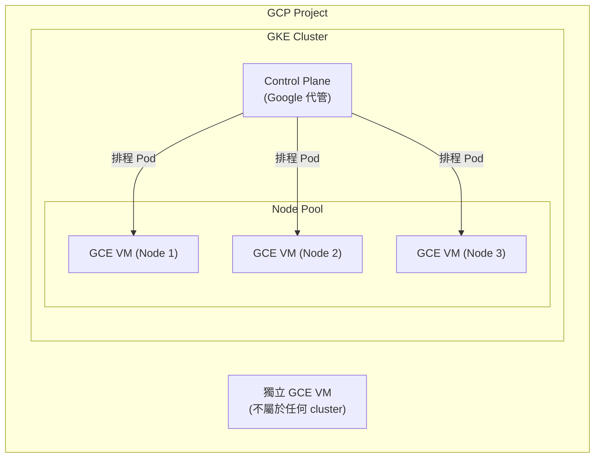

# GCP VM（Compute Engine）與 GKE 的關係

> VM（Compute Engine）是運算資源的最底層單位；GKE 是建立在一群 VM 之上、幫忙自動化管理容器排程的 Kubernetes 服務。GKE 的 node 本身就是 Compute Engine VM，只是這些 VM 被 Kubernetes control plane 接管，用來跑 Pod。

## 分層關係

- Node Pool 裡的 VM 本質上就是普通的 Compute Engine 執行個體，只是開機時裝了 `kubelet`、`containerd` 等 Kubernetes node 元件，並向 control plane 註冊成為 node。
- 獨立的 GCE VM 跟 GKE 完全無關，說明 VM 是比 GKE 更底層、更通用的資源，GKE 只是「VM 的其中一種用法」。

## 兩者各自負責什麼

| 項目 | Compute Engine VM | GKE |
|---|---|---|
| 本質 | 一台虛擬機器（OS + CPU + 記憶體 + 磁碟） | Kubernetes 管理平台（control plane + node pool） |
| 管理單位 | 整台 VM（OS 更新、process、網路設定） | Pod / Deployment / Service（Kubernetes 物件） |
| 排程粒度 | 自行決定哪個 process 跑在哪台 VM | Kubernetes scheduler 自動把 Pod 分配到 node |
| 擴縮 | 手動或靠 Managed Instance Group（MIG）做 VM 層級的 autoscaling | 靠 Horizontal Pod Autoscaler（Pod 層級）+ Cluster Autoscaler（node 層級，底層一樣是在加減 VM） |
| 故障恢復 | VM 掛了要自己重建或靠 MIG 重開 | Node 掛了，control plane 會把上面的 Pod 重新排程到其他 node；node 本身則可能透過 node auto-repair 重建 |

## GKE 其實是「VM + 自動化」的組合

GKE 可以理解成在一堆 Compute Engine VM 上面疊加了一層控制平面，幫忙做三件 VM 層級自己要手刻的事：

1. **自動把 Pod 分配到合適的 VM 上**（bin packing），不需要自己決定哪個容器跑哪台機器。
2. **VM 層級的 node pool 管理**：用一個指令定義一組 VM 規格（machine type、磁碟、是否用 Spot/Preemptible VM），GKE 幫忙批次建立、汰換、升級這些 VM。
3. **跟其他 GCP 服務整合**（Cloud Load Balancing、IAM、VPC-native networking），讓這群 VM 組成的叢集可以用 Kubernetes 的語意（Service、Ingress）對外曝露，不用在每台 VM 上設防火牆規則、LB backend。

另外還有 **GKE Autopilot** 模式——這種模式下 Google 完全接管 node 的生命週期，使用者甚至看不到底層 VM 的存在，只需要定義 Pod 要多少 CPU/記憶體，Google 會決定要開幾台、多大的 VM。這進一步說明 VM 在 GKE 裡是「實作細節」，而不是必須直接操作的對象。

## 什麼時候用 VM，什麼時候用 GKE

- **直接用 VM**：單體應用、需要完全控制 OS、特殊 kernel module、傳統 lift-and-shift 的 legacy 系統，或只是要跑一個簡單的背景服務。
- **用 GKE**：微服務架構、需要容器化部署、頻繁上版本/滾動更新、需要水平擴縮、多團隊共用叢集資源。

## 常見誤解釐清

- GKE 不是「取代」VM，而是建立在 VM 之上的編排層；就算選了 GKE，計費帳單底層還是在算 VM 的 vCPU/記憶體用量（加上 GKE 的 cluster management fee，Autopilot 模式下另計）。
- Node pool 升級 Kubernetes 版本時，背後動作其實是建立新版 VM image 的 node、把舊 node 上的 Pod 排程過去、再刪掉舊 VM——本質上仍是 VM 層級的汰換操作，只是 GKE 把這個流程自動化、並盡量做到對運行中服務無感。

## 相關筆記

- [Terraform 與 GCP 的整合：Infrastructure as Code 實踐](#/sre/05-gcp/terraform-gcp-overview.mdx)
- [GKE Pod 記憶體管理：Request 與 Limit 的實際運作](#/sre/05-gcp/gke-pod-memory-without-limit.mdx)
- [GCP VPC Network 的架構與核心概念](#/sre/05-gcp/gcp-vpc-network.mdx)
