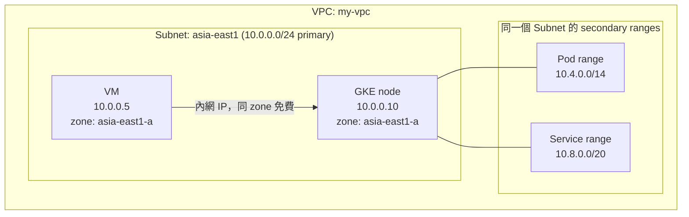
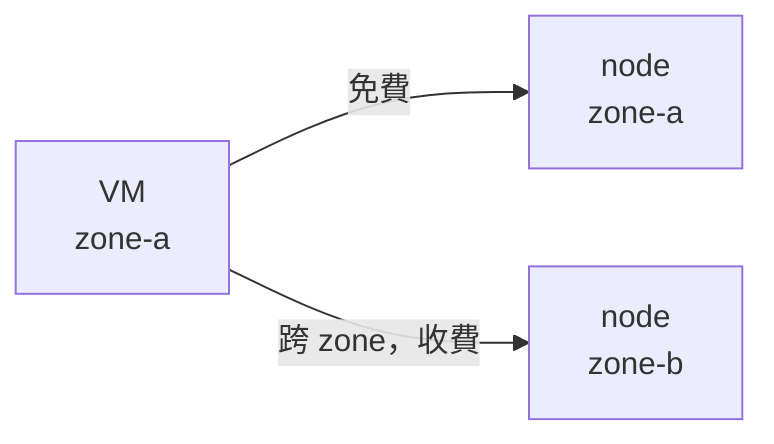

# GKE Cluster 與 VM 之間的內網互通與資料傳輸費用

> 一句話版本：資料傳輸費用取決於「同一個 zone、走內網 IP」，而不是「是否共用同一個 Subnet」。GKE 與 VM 只要在同一個 VPC 內就能走內網互通；要完全免費，還需要兩邊在同一個 zone，並且通訊路徑不繞外網 IP 或跨 zone 的負載平衡。

## Step 1：先釐清「同一個 Subnet」與「免費」的關係

常見誤解是「Cluster 和 VM 放同一個 Subnet 就不用付傳輸費」。實際上 GCP 的網路計費看的是**流量的來源與目的地位置**，與 Subnet 無關：

| 流量路徑 | 是否收費 |
|----------|----------|
| 同一個 zone，內網 IP 互通 | 免費 |
| 同一個 region、不同 zone，內網 IP | 收費（跨 zone egress，按 GB 計價） |
| 不同 region | 收費（依 region 組合計價） |
| 任一端走外部 IP（即使同 zone） | 收費（視為 internet egress） |

> 實際單價會調整，請以 GCP 官方 Network pricing 頁面為準；重點是理解「哪些路徑會被計費」。

因此：

- 同 Subnet 不保證免費：Subnet 是 regional，同一個 Subnet 裡的兩台 VM 可能落在不同 zone，照樣收跨 zone 費用。
- 不同 Subnet 也可能免費：只要同 VPC、同 zone、走內網 IP，費用就是 0。

## Step 2：GKE 的網路建立在 VPC + Subnet 之上

GKE 的 node 本質上就是 Compute Engine VM（參考 [GCP VM（Compute Engine）與 GKE 的關係](#/sre/05-gcp/gcp-vm-and-gke-relationship.mdx)），所以建立 Cluster 時要指定：

- **Network**：Cluster 所在的 VPC。
- **Subnetwork**：node 的內網 IP 從這個 Subnet 的 primary range 配發。

要讓 Cluster 與既有 VM 互通，**選同一個 VPC 就夠了**；選同一個 Subnet 是可行且常見的做法，但不是必要條件。



## Step 3：VPC-native cluster 與 secondary range

現行 GKE 預設是 **VPC-native（alias IP）** 模式，同一個 Subnet 會被拆成三種用途：

| 範圍 | 用途 | 來源 |
|------|------|------|
| Primary range | node（VM）的內網 IP | Subnet 的主要 CIDR |
| Secondary range（Pod） | 每個 Pod 的 IP | Subnet 的 secondary range |
| Secondary range（Service） | ClusterIP Service 的虛擬 IP | Subnet 的 secondary range |

重點：

- Pod IP 是 VPC 內**可路由**的真實 alias IP，所以同 VPC 的 VM 可以直接用 Pod IP 連進去（防火牆放行的前提下）。
- Service 的 ClusterIP 只在 cluster 內有效，**VM 無法直接連**；要從 VM 連進 Cluster，通常用 Internal Load Balancer（Internal LB）、NEG，或直接連 Pod IP。
- 共用既有 Subnet 時，需要在該 Subnet 先建好 secondary range，或讓 GKE 自動建立。
- 規劃 CIDR 時，Pod range 通常要比 node range 大很多（預設每個 node 預留 /24 給 Pod）。

```bash
# 在既有 Subnet 上新增 Pod / Service 的 secondary range
gcloud compute networks subnets update my-subnet \
  --region=asia-east1 \
  --add-secondary-ranges=gke-pods=10.4.0.0/14,gke-services=10.8.0.0/20

# 建立 Cluster，指定同一個 VPC / Subnet
gcloud container clusters create my-cluster \
  --zone=asia-east1-a \
  --network=my-vpc \
  --subnetwork=my-subnet \
  --enable-ip-alias \
  --cluster-secondary-range-name=gke-pods \
  --services-secondary-range-name=gke-services
```

## Step 4：怎麼做到真正的「零傳輸費」

要讓 VM 與 GKE 之間的流量免費，需同時滿足：

1. **同一個 VPC**（或透過 VPC Peering，Peering 內的內網流量計價規則與同 VPC 相同）。
2. **同一個 zone**：VM 與 Pod 所在的 node 在同一個 zone。
3. **走內網 IP**：不要用外部 IP 或經過 external load balancer。

### 容易踩到的收費點

| 情境 | 為什麼收費 | 對策 |
|------|------------|------|
| Regional cluster，node 分散在 3 個 zone | VM 打到的 Pod 可能在別的 zone | 改用 zonal cluster，或限制 node pool 的 `node-locations` 到 VM 所在 zone |
| Service 背後的 Pod 分布在多個 zone | kube-proxy 隨機轉發，可能跨 zone | 啟用 topology aware routing，讓流量優先留在同 zone |
| 透過 Internal LB 連入 | LB 可能把流量轉去其他 zone；LB 本身也有 data processing 費用 | 直接連 Pod IP / NEG，或確認 LB 的 zone 親和設定 |
| VM 用外部 IP 連 Cluster 的外部 IP | 視為 internet egress | 一律使用內網 IP |
| 不同 region | 跨 region egress | 把 VM 與 Cluster 放同 region |



## Step 5：防火牆別忘了

同 VPC 並不代表互通，防火牆預設 ingress 全拒（`default` VPC 會預建 `default-allow-internal`，Custom VPC 則沒有）：

- GKE 會自動建立 node 之間所需的規則，但**不會替你的 VM 開放進入 node / Pod 的規則**。
- 需要新增 ingress 規則，source 為 VM 的 service account 或 tag，目標為 node 的 tag，且 port 要涵蓋服務埠。
- 來源 / 目的 range 要同時考慮 **node range** 與 **Pod range**，因為 Pod IP 在 secondary range。

```bash
gcloud compute firewall-rules create allow-vm-to-gke-pods \
  --network=my-vpc \
  --allow=tcp:8080 \
  --source-service-accounts=vm-sa@PROJECT.iam.gserviceaccount.com \
  --destination-ranges=10.4.0.0/14
```

## Step 6：要不要共用同一個 Subnet？

| 做法 | 優點 | 缺點 |
|------|------|------|
| 共用同一個 Subnet | 簡單、防火牆規則好寫、IP 規劃集中 | 容量需預留 node 數量成長；VM 與 node 混在同一段，權限較難切分 |
| 同 VPC、不同 Subnet | 職責分離，可用不同 Subnet 套不同規則與 Flow Logs | 多管一個 Subnet；仍需同 zone 才免費 |
| 不同 VPC + Peering | 隔離最強 | CIDR 不能重疊；Peering 不可傳遞；管理成本較高 |

結論：**共用同一個 Subnet 可行且最簡單，但免費與否不取決於它**；真正決定費用的是 zone 與 IP 類型。

## 小結

- VM 與 GKE 內網互通的必要條件是**同 VPC + 防火牆放行**，同 Subnet 只是方便。
- 零傳輸費需要**同 zone + 內網 IP**；Regional cluster、Internal LB、跨 zone Service 轉發是最常見的隱性成本。
- GKE 使用 VPC-native，Pod / Service IP 來自 Subnet 的 secondary range，建立前先規劃好 CIDR。
- 想驗證實際費用，可開啟 VPC Flow Logs 或 Billing export 到 BigQuery，依 SKU 查看 inter-zone egress 的用量。

## 相關筆記

- [GCP VPC Network 的架構與核心概念](#/sre/05-gcp/gcp-vpc-network.mdx)
- [GCP VM（Compute Engine）與 GKE 的關係](#/sre/05-gcp/gcp-vm-and-gke-relationship.mdx)
