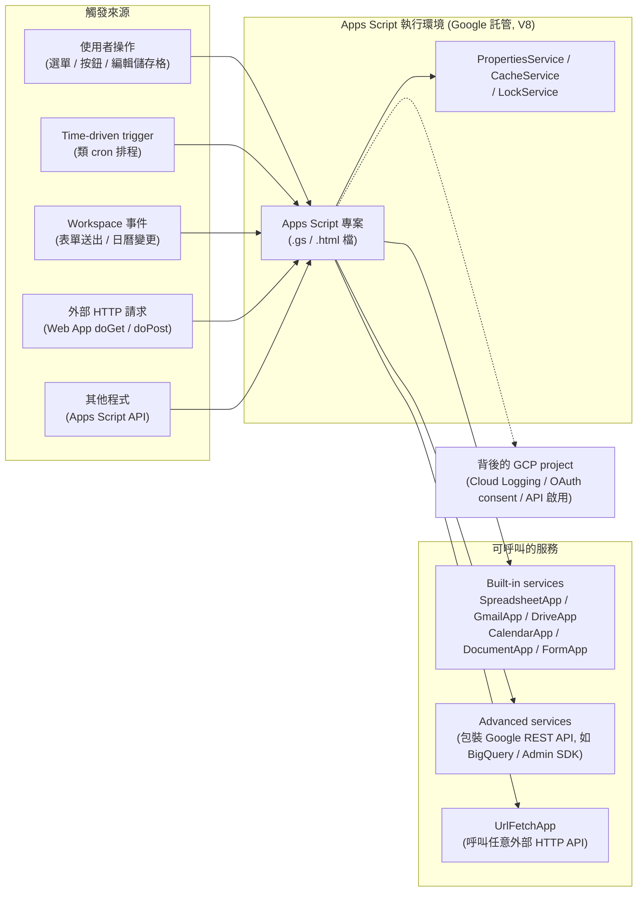
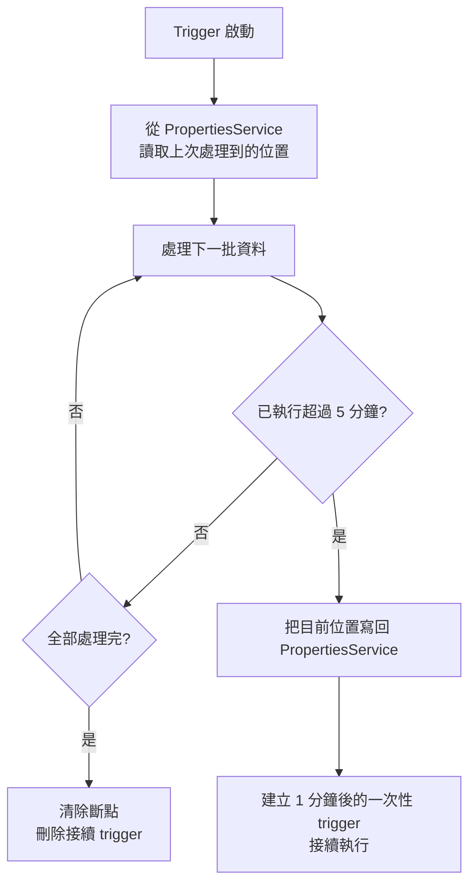

# Google Apps Script 的核心概念與運作原理

> 一句話版本：Google Apps Script 是 Google 託管的 serverless JavaScript 執行環境，內建 Gmail、Sheets、Drive、Calendar 等 Workspace 服務的 API 物件，讓你不用架 server、不用處理 OAuth，就能寫程式自動化 Google Workspace，並以 trigger、Web App、Add-on 等形式對外運作。

## Step 1：定位——它到底是什麼

把 Apps Script 拆成三個關鍵字來理解：

| 關鍵字 | 含義 |
|--------|------|
| **JavaScript** | 語言是標準 JavaScript（ES2015+），跑在 Google 端的 **V8 runtime**；不是 Node.js，沒有 `npm`、`fs`、`require` |
| **Serverless** | 程式碼存在 Google 端、在 Google 的機器上執行，沒有機器要維運，也不用付主機費用（受 quota 限制） |
| **Workspace 原生整合** | 執行環境預先注入 `SpreadsheetApp`、`GmailApp`、`DriveApp` 等全域物件，呼叫時自動以使用者身分完成 OAuth 授權 |

可以把它想成「**Workspace 專屬的 Cloud Functions**」：一樣是事件驅動、按需執行的函式，但它的殺手級特色是——操作 Workspace 資料幾乎不需要任何 boilerplate。

同樣的「讀取一份試算表」，用一般 GCP 服務要做的事：

1. 建 GCP project、啟用 Sheets API
2. 建 service account 或 OAuth client，處理 credential
3. 安裝 client library、寫認證程式碼
4. 部署到 Cloud Run / Cloud Functions

在 Apps Script 裡只要一行：

```javascript
const rows = SpreadsheetApp.openById('SHEET_ID').getSheetByName('訂單').getDataRange().getValues();
```

## Step 2：整體架構

以 C4 Container 層次來看，Apps Script 專案是一個被 Google 託管的執行單元，前面接各種「觸發來源」，後面接各種「服務」：



重點有三個：

- **觸發來源很多元**：同一份程式碼可以同時被選單、排程、HTTP 請求呼叫。
- **服務分三層**：Built-in services（最好用）→ Advanced services（官方 REST API 的薄包裝）→ `UrlFetchApp`（萬用 HTTP client，接任何第三方 API）。
- **背後其實有一個 GCP project**：每個 Apps Script 專案預設綁一個隱藏的 default GCP project，負責 API 啟用、OAuth 同意畫面與 log 收集（Step 7 詳述）。

## Step 3：兩種專案型態

| 型態 | 建立方式 | 特性 | 典型用途 |
|------|----------|------|----------|
| **Container-bound** | 在 Sheets / Docs / Forms 內點「擴充功能 → Apps Script」 | 綁定某個檔案；可用 `SpreadsheetApp.getActiveSpreadsheet()` 拿到「自己所在的檔案」；能加自訂選單、simple trigger | 某份報表專用的自動化、自訂函式 |
| **Standalone** | 在 [script.google.com](https://script.google.com) 直接建立 | 獨立存在於 Drive；要操作檔案得用 ID 開啟 | Web App、跨多份檔案的排程任務、Library、Add-on |

判斷原則很簡單：**邏輯只服務一份文件 → bound；服務多份文件或對外提供服務 → standalone**。

## Step 4：程式怎麼被執行——觸發機制總覽

Apps Script 沒有 `main()`，所有程式都是「某個事件呼叫某個函式」。理解觸發機制是掌握 Apps Script 的關鍵：

| 機制 | 怎麼觸發 | 執行身分 | 注意事項 |
|------|----------|----------|----------|
| **Simple trigger** | 保留函式名稱：`onOpen(e)`、`onEdit(e)`、`onInstall(e)`、`doGet(e)` / `doPost(e)` | 當下操作的使用者 | 不能呼叫需要授權的服務（如寄信）、執行上限 30 秒 |
| **Installable trigger** | 手動或程式建立：時間驅動、表單送出、日曆更新、`onChange` 等 | **建立 trigger 的人** | 可呼叫需要授權的服務；時間驅動 trigger 就是 Apps Script 的 cron |
| **Custom function** | 在儲存格寫 `=MYFUNC(A1)` | 匿名、權限受限 | 只能回傳值、不能修改其他儲存格，上限 30 秒 |
| **Web App** | 部署後取得 URL，HTTP 請求呼叫 `doGet` / `doPost` | 部署時選「以我身分」或「以存取者身分」 | 可做輕量 API、webhook 接收端、HTML 表單 |
| **Add-on** | 發布到 Workspace Marketplace，出現在 Gmail / Sheets 側欄 | 安裝的使用者 | 需要審核，適合給大量使用者用 |
| **Apps Script API** | 外部程式透過 REST 呼叫 `scripts.run` | 呼叫者的 OAuth token | 需要標準 GCP project |

「**installable trigger 以建立者身分執行**」是很多事故的來源：建立 trigger 的同事離職、帳號被停用後，trigger 會整批失效。

## Step 5：程式碼範例

### 範例 1：每天早上從試算表彙整數字並寄信（Installable time-driven trigger）

```javascript
/**
 * 每日報表：統計「訂單」分頁中今天的訂單數與金額，寄給團隊。
 */
function sendDailyReport() {
  const sheet = SpreadsheetApp.openById('SHEET_ID').getSheetByName('訂單');

  // 一次讀整個範圍（批次），不要在迴圈裡逐格 getValue()
  const [header, ...rows] = sheet.getDataRange().getValues();
  const dateCol = header.indexOf('日期');
  const amountCol = header.indexOf('金額');

  const today = Utilities.formatDate(new Date(), 'Asia/Taipei', 'yyyy-MM-dd');
  const todayRows = rows.filter(r =>
    Utilities.formatDate(new Date(r[dateCol]), 'Asia/Taipei', 'yyyy-MM-dd') === today);
  const total = todayRows.reduce((sum, r) => sum + Number(r[amountCol]), 0);

  MailApp.sendEmail({
    to: 'team@example.com',
    subject: `[日報] ${today} 訂單 ${todayRows.length} 筆`,
    htmlBody: `<p>今日訂單 <b>${todayRows.length}</b> 筆，總額 <b>${total}</b> 元。</p>`,
  });
}

/** 執行一次即可建立排程：每天 9 點左右觸發 */
function installTrigger() {
  ScriptApp.newTrigger('sendDailyReport')
    .timeBased()
    .everyDays(1)
    .atHour(9)
    .inTimezone('Asia/Taipei')
    .create();
}
```

注意 `atHour(9)` 只保證在 9:00–10:00 之間的某個時間點執行，**時間驅動 trigger 不保證精確時間**。

### 範例 2：Web App 當作 webhook 接收端

```javascript
/** 部署為 Web App 後，外部系統 POST JSON 進來，寫入試算表 */
function doPost(e) {
  const lock = LockService.getScriptLock();
  lock.waitLock(10 * 1000);  // 避免同時多筆請求造成 appendRow 互相覆蓋
  try {
    const payload = JSON.parse(e.postData.contents);
    SpreadsheetApp.openById('SHEET_ID')
      .getSheetByName('webhook')
      .appendRow([new Date(), payload.event, JSON.stringify(payload)]);
    return ContentService.createTextOutput(JSON.stringify({ ok: true }))
      .setMimeType(ContentService.MimeType.JSON);
  } finally {
    lock.releaseLock();
  }
}
```

Web App 的限制：無法自訂 HTTP status code（永遠回 200 或經過 302 redirect），也無法讀取 request header，所以不適合當正式的 API gateway。

### 範例 3：自訂試算表函式

```javascript
/**
 * 在儲存格輸入 =TWD_TO_USD(A2) 即可換算
 * @customfunction
 */
function TWD_TO_USD(amount) {
  const rate = 32.5;  // 實務上可用 CacheService 快取 UrlFetchApp 取得的匯率
  return Math.round((amount / rate) * 100) / 100;
}
```

## Step 6：常用的內建服務

| 類別 | 服務 | 用途 |
|------|------|------|
| Workspace | `SpreadsheetApp`、`DocumentApp`、`SlidesApp`、`FormApp` | 讀寫 Sheets / Docs / Slides / Forms |
| Workspace | `GmailApp`、`MailApp` | 搜尋與寄送郵件（`MailApp` 只能寄信，授權範圍較小） |
| Workspace | `DriveApp`、`CalendarApp` | 檔案管理、行事曆事件 |
| 外部連線 | `UrlFetchApp` | 發 HTTP 請求呼叫任意 API（Slack webhook、內部服務…） |
| 狀態儲存 | `PropertiesService` | 持久化 key-value（存設定、API token、斷點位置） |
| 快取 | `CacheService` | 暫存資料，最長 6 小時 |
| 並發控制 | `LockService` | 互斥鎖，避免多個執行同時改同一份資料 |
| 工具 | `Utilities`、`ScriptApp`、`HtmlService` | 日期格式化與編碼、管理 trigger、產生 HTML UI |

Advanced services（如 BigQuery、Admin SDK Directory、Drive API v3）需要在編輯器手動啟用，本質上是對官方 REST API 的包裝，功能比 built-in services 完整，但寫法較囉嗦。

## Step 7：權限、身分與背後的 GCP project

### OAuth scope 自動推導

Apps Script 會**靜態分析程式碼**用到哪些服務，自動推導出需要的 OAuth scope；第一次執行時跳出授權畫面。也可以在 `appsscript.json` manifest 中明確列出 `oauthScopes`，限縮成最小權限：

```json
{
  "timeZone": "Asia/Taipei",
  "runtimeVersion": "V8",
  "oauthScopes": [
    "https://www.googleapis.com/auth/spreadsheets.readonly",
    "https://www.googleapis.com/auth/script.send_mail"
  ]
}
```

### Default project vs Standard project

| | Default GCP project | Standard GCP project |
|---|---|---|
| 建立方式 | 建立 Apps Script 時自動產生、隱藏 | 自己在 GCP Console 建立後，到專案設定綁定 |
| Cloud Logging | 只能透過 Apps Script 介面看執行紀錄 | 可在 Logs Explorer 查詢、建 log-based metric 與告警 |
| OAuth 同意畫面 | 不可自訂 | 可自訂，Add-on 與 Apps Script API 必須用這種 |
| 適用 | 個人小工具 | 團隊、正式環境、需要可觀測性 |

`console.log()` 的輸出會寫到 Cloud Logging；如果是正式運作的自動化，**建議綁定 standard project**，才能用 Cloud Logging 與 Cloud Monitoring 做告警。

## Step 8：Quota 與限制（設計時一定要先看）

Apps Script 免費，代價是一堆硬性 quota。以下是常見數字的量級，實際值以官方 Quotas 頁面為準：

| 限制 | 個人 Gmail 帳號 | Workspace 帳號 |
|------|----------------|----------------|
| 單次執行時間 | 6 分鐘 | 6 分鐘 |
| Custom function 單次執行 | 30 秒 | 30 秒 |
| Trigger 每日總執行時間 | 90 分鐘 | 6 小時 |
| 每日寄信收件人數 | 約 100 | 約 1,500 |
| `UrlFetchApp` 每日呼叫數 | 約 20,000 | 約 100,000 |
| 每位使用者同時執行數 | 30 | 30 |

其中**6 分鐘執行上限**最常撞到。處理大量資料時的標準解法是「分批 + 斷點續跑」：



## Step 9：效能關鍵——減少服務呼叫次數

每一次 `getValue()`、`setValue()` 都是一次對 Sheets 後端的遠端呼叫，耗時約數十到數百毫秒。逐格操作是 Apps Script 最常見的效能地雷：

```javascript
// ❌ 1000 列 × 每列 2 次 RPC = 2000 次遠端呼叫，很容易超過 6 分鐘
for (let i = 2; i <= 1001; i++) {
  const v = sheet.getRange(i, 1).getValue();
  sheet.getRange(i, 2).setValue(v * 2);
}

// ✅ 讀一次、在記憶體運算、寫一次 = 2 次遠端呼叫
const values = sheet.getRange(2, 1, 1000, 1).getValues();
const doubled = values.map(([v]) => [v * 2]);
sheet.getRange(2, 2, 1000, 1).setValues(doubled);
```

若批次總耗時為 $T$，單次遠端呼叫延遲為 $t_{rpc}$、呼叫次數為 $n$，則：

$$
T \approx n \cdot t_{rpc} + T_{compute}
$$

Apps Script 裡 $T_{compute}$ 通常可忽略，**優化的核心就是把 $n$ 降到最低**。同理，重複讀取的外部資料用 `CacheService` 快取，`UrlFetchApp.fetchAll()` 可以平行發多個 HTTP 請求。

## Step 10：開發與部署流程

- **線上編輯器**：script.google.com 內建 IDE，適合小腳本。
- **clasp**（Command Line Apps Script Projects）：Google 官方 CLI，讓你在本地用 Git 管理、用 TypeScript 撰寫，再 `clasp push` 上傳：

```bash
npm install -g @google/clasp
clasp login
clasp clone <scriptId>     # 把雲端專案拉到本地
clasp push                 # 上傳本地程式碼
clasp deploy -d "v1.2"     # 建立新版本部署
```

- **部署版本**：Web App / Add-on 有「head deployment」（永遠指向最新程式碼，給測試用）與「versioned deployment」（固定版本，給正式用）的區分，等同一個簡易的 release 機制；正式環境應該用 versioned deployment，改壞了可以切回舊版本。

## Step 11：適用場景與選型

| 情境 | 建議 |
|------|------|
| 自動化 Sheets / Gmail / Drive 的重複作業 | ✅ Apps Script 最佳選擇 |
| 試算表的自訂選單、自訂函式、側欄 UI | ✅ 只有 Apps Script 做得到 |
| 每天跑一次的輕量排程、彙整報表 | ✅ time-driven trigger 即可 |
| 接收低流量 webhook、轉發 Slack 通知 | ⚠️ 可以，但無法自訂 status code、無 header |
| 需要 SLA、高 QPS、低延遲的 API | ❌ 改用 Cloud Run / Cloud Functions |
| 處理大量資料、執行超過數分鐘的批次 | ❌ 改用 Cloud Run Jobs、BigQuery |
| 需要 npm 生態系、自訂 runtime | ❌ 改用 Cloud Run |

與相近工具的比較：

| | Apps Script | Cloud Functions / Cloud Run | AppSheet / Zapier 類 no-code |
|---|---|---|---|
| 撰寫方式 | JavaScript | 任意語言 / 容器 | 拖拉設定 |
| Workspace 整合 | 原生、免 OAuth 設定 | 要自己處理認證 | 有現成連接器 |
| 擴展性與 SLA | 受 quota 限制、無 SLA | 可水平擴展、有 SLA | 依方案而定 |
| 成本 | 免費（含在帳號內） | 按用量計費 | 訂閱制 |

## Step 12：從 SRE 角度看 Apps Script 的維運風險

Apps Script 很容易變成「某個人寫的、沒人知道在跑」的影子系統（shadow IT）。若它承擔了業務流程，要用正式系統的標準看待：

1. **所有權（bus factor）**：腳本與 installable trigger 都掛在個人帳號上。建議放在共用雲端硬碟（Shared Drive）、用團隊帳號建立 trigger，並在文件記錄有哪些 trigger。
2. **可觀測性**：綁定 standard GCP project，把 `console.error()` 導到 Cloud Logging，建 log-based metric 與 alerting policy；trigger 失敗時 Google 也會寄失敗通知信給 trigger 擁有者，記得別讓它進垃圾信箱。
3. **冪等性**：time-driven trigger 可能延遲或重跑，寫入動作要設計成重複執行也不會產生重複資料（例如先檢查是否已處理）。
4. **並發控制**：Web App 與 `onFormSubmit` 可能同時多個執行，修改共享資料前用 `LockService` 上鎖。
5. **機密管理**：API token 存在 `PropertiesService`（Script Properties），不要寫死在程式碼裡；更嚴格的情境可透過 standard project 存取 Secret Manager。
6. **版本控管**：用 clasp + Git 管理程式碼，正式部署走 versioned deployment，保留回滾能力。

## 相關筆記

- [Google Apps Script Web App 的運作方式、應用場景與限制](#/sre/05-gcp/apps-script-web-app.mdx)
- [GCP Cloud Run 的原理與應用](#/sre/05-gcp/gcp-cloud-run-overview.mdx)
- [GCP Cloud Scheduler 的 Timeout 限制與配置](#/sre/05-gcp/cloud-scheduler-timeout.mdx)
- [Kubernetes CronJob 與 GCP Cloud Scheduler 的差異與選型](#/sre/05-gcp/k8s-cronjob-vs-cloud-scheduler.mdx)
- [GCP BigQuery 核心功能與計費模式](#/sre/05-gcp/gcp-bigquery-overview.mdx)
- [GCP Cloud Observability 套件總覽](#/sre/05-gcp/gcp-cloud-observability-overview.mdx)
