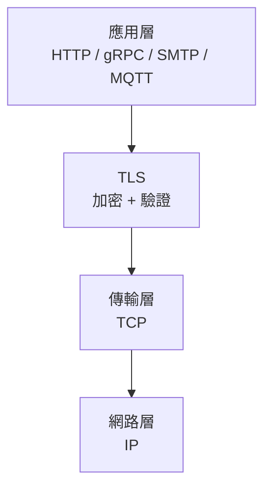
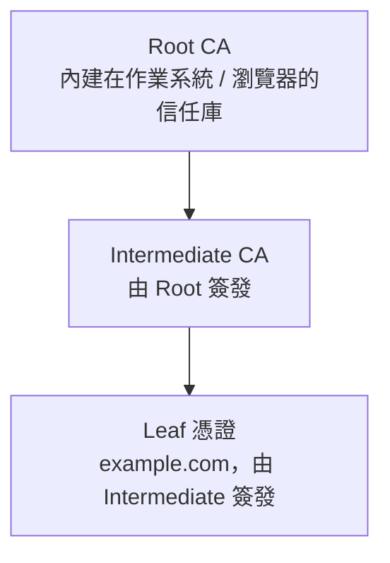
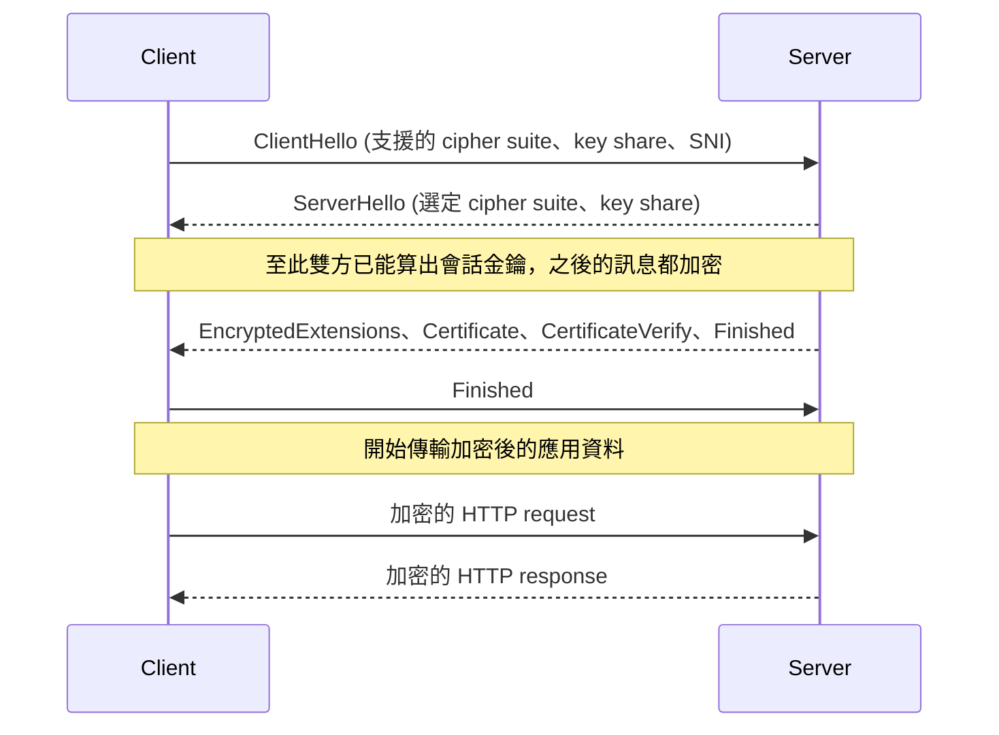

# TLS 的原理：加密、驗證與握手流程

> 一句話版本：TLS（Transport Layer Security）是建立在 TCP 之上的安全協定，讓兩端在不安全的網路上取得三件事：**機密性**（別人看不到內容）、**完整性**（內容不會被竄改）、**身分驗證**（確認對方真的是它宣稱的那台伺服器）。HTTPS 就是 HTTP 跑在 TLS 上。

## Step 1：為什麼需要 TLS

HTTP 是明文協定。封包從你的瀏覽器到伺服器要經過 Wi-Fi、ISP、多個路由器，任何一個中間節點都可以：

- **竊聽**：讀到密碼、token、個資。
- **竄改**：在回應中插入廣告或惡意腳本。
- **冒充**：假裝自己是目標網站（中間人攻擊，MITM）。

TLS 針對這三種威脅各給一個對策：

| 威脅 | TLS 的對策 | 底層技術 |
|------|-----------|----------|
| 竊聽 | 機密性：加密傳輸內容 | 對稱加密（AES-GCM、ChaCha20） |
| 竄改 | 完整性：偵測內容被改動 | AEAD 的認證標籤（MAC） |
| 冒充 | 身分驗證：驗證伺服器憑證 | X.509 憑證 + 公開金鑰簽章 |

## Step 2：SSL 與 TLS 的關係

- **SSL**：Netscape 在 1990 年代設計（SSL 2.0、3.0），已因嚴重漏洞（如 POODLE）全面廢棄。
- **TLS**：SSL 的後繼者，由 IETF 標準化。

| 版本 | 狀態 |
|------|------|
| TLS 1.0 / 1.1 | 已棄用，不應再啟用 |
| TLS 1.2 | 仍廣泛使用，設定得當仍安全 |
| TLS 1.3 | 目前建議版本（RFC 8446），握手更快、移除不安全選項 |

日常說的「SSL 憑證」其實幾乎都是給 TLS 用的憑證，只是沿用舊名稱。

## Step 3：TLS 在協定堆疊的位置



TLS 夾在應用層與 TCP 之間，對應用程式透明：HTTP 的內容原封不動，只是在送出前被加密。因此 gRPC、資料庫連線、SMTP 等協定都能套用 TLS。QUIC / HTTP/3 則把 TLS 1.3 直接整合進傳輸協定，跑在 UDP 上。

## Step 4：核心密碼學元件

TLS 同時用到兩類加密，各取所長：

1. **非對稱加密**（公開金鑰）：有公鑰與私鑰，不需事先共享祕密，但運算慢。用於**簽章**與**金鑰交換**。
2. **對稱加密**：雙方持有同一把金鑰，速度快。用於**加密實際資料**。

策略是：先用非對稱技術安全地協商出一把「會話金鑰」，之後所有資料都用這把對稱金鑰加密。

### 金鑰交換與 Forward Secrecy

現代 TLS 使用 **ECDHE**（臨時橢圓曲線 Diffie-Hellman）協商金鑰：

- 雙方各產生一組**臨時**金鑰對，只交換公鑰，各自算出相同的共享祕密。
- 竊聽者即使看到全部封包，也算不出祕密。
- 臨時金鑰用完即丟，因此即使伺服器的長期私鑰日後外洩，**過去錄下的流量也無法解密**，這叫 **Forward Secrecy**。

TLS 1.3 已強制使用具備 forward secrecy 的金鑰交換，並移除了舊的 RSA 金鑰傳輸。

### AEAD

資料加密採用 **AEAD**（Authenticated Encryption with Associated Data），例如 AES-256-GCM 與 ChaCha20-Poly1305：加密同時產生認證標籤，只要密文被改動一個 bit，解密就會失敗。

## Step 5：憑證與信任鏈

「對方真的是 example.com 嗎？」靠**憑證**回答。

**X.509 憑證**包含：網域名稱（SAN）、伺服器公鑰、有效期限、簽發者（CA）、簽發者的數位簽章。

驗證靠**信任鏈**：



client 驗證流程：

1. 伺服器送出 leaf 憑證與 intermediate 憑證。
2. client 逐層檢查簽章，直到追溯到信任庫中的 Root CA。
3. 檢查網域是否與憑證的 SAN 相符、是否在有效期內、是否被撤銷（CRL / OCSP）。
4. 伺服器還要用私鑰對握手內容簽章，證明它**持有**這張憑證的私鑰，而不只是複製了憑證。

任何一步失敗，瀏覽器就會顯示憑證錯誤。

## Step 6：TLS 1.3 握手流程



重點：

- **1-RTT**：TLS 1.3 只需一個來回就完成握手（TLS 1.2 需要兩個）。
- **SNI**（Server Name Indication）：ClientHello 帶上想連的 hostname，讓同一個 IP 的伺服器可以依網域挑選對應憑證。這也是 Load Balancer 上 certificate map 運作的基礎。
- **Session resumption**：重連時可用先前的 ticket 省略部分流程；TLS 1.3 還有 0-RTT，但第一個封包可能被重放（replay），只適合冪等請求。

## Step 7：Cipher Suite 是什麼

Cipher suite 是雙方協商要用哪一組演算法。

- TLS 1.2 的名稱長這樣：`TLS_ECDHE_RSA_WITH_AES_128_GCM_SHA256`，依序是金鑰交換、簽章演算法、對稱加密、雜湊。
- TLS 1.3 大幅精簡，只剩幾個，例如 `TLS_AES_128_GCM_SHA256`，金鑰交換與簽章獨立協商。

實務上不要自己挑演算法，直接採用平台或 Mozilla 建議的設定檔（modern / intermediate）。

## Step 8：單向 TLS 與 mTLS

| 模式 | 誰驗證誰 | 場景 |
|------|----------|------|
| 單向 TLS | 只有 client 驗證 server | 一般網站、公開 API |
| mTLS（雙向） | 雙方都出示憑證並互相驗證 | 微服務之間、service mesh、零信任網路、B2B API |

mTLS 讓 server 能以憑證確認「這是哪個服務在呼叫」，是 service mesh（如 Istio）的服務間身分基礎。

## Step 9：TLS 終止（TLS Termination）

常見架構是在 Load Balancer 或 reverse proxy 終止 TLS：

- **終止於 LB**：client 到 LB 加密，LB 到後端用明文 HTTP。優點是集中管理憑證、後端不吃加解密成本；缺點是內網是明文，若內網不可信就有風險。
- **重新加密（re-encrypt）**：LB 解密檢查後，再用 TLS 連到後端。
- **端到端**：LB 只做 TCP 層轉發（passthrough），後端自己終止 TLS。

選擇取決於安全需求與是否需要在 LB 做 L7 路由。憑證在雲端的集中管理方式可參考下方的 Certificate Manager 筆記。

## Step 10：實用除錯指令

```bash
# 看伺服器送出的憑證鏈與協商結果
openssl s_client -connect example.com:443 -servername example.com

# 查憑證內容（網域、有效期、簽發者）
echo | openssl s_client -connect example.com:443 -servername example.com 2>/dev/null \
  | openssl x509 -noout -subject -issuer -dates

# 強制指定 TLS 版本測試
openssl s_client -connect example.com:443 -tls1_3
```

## 常見錯誤對照

| 症狀 | 常見原因 |
|------|----------|
| 憑證已過期 | 忘記續期，或自動續期失敗 |
| 網域不符（hostname mismatch） | 憑證的 SAN 不含目前存取的網域 |
| 無法建立信任鏈 | 伺服器沒送 intermediate 憑證，或 client 沒有對應 Root CA |
| handshake failure | 雙方沒有共同支援的 TLS 版本或 cipher suite |
| 自簽憑證不受信任 | 內部 CA 的 Root 沒有安裝到 client 信任庫 |

## 重點整理

1. TLS 提供**機密性、完整性、身分驗證**，HTTPS 是 HTTP over TLS。
2. 用非對稱技術協商金鑰與驗證身分，再用對稱加密傳資料。
3. ECDHE 帶來 forward secrecy，TLS 1.3 把它變成強制。
4. 信任來自憑證鏈，最終追溯到作業系統或瀏覽器內建的 Root CA。
5. 只該啟用 TLS 1.2 與 1.3，cipher suite 用官方建議設定檔。

## 相關筆記

- [GCP Certificate Manager 的核心概念與功能](#/sre/05-gcp/gcp-certificate-manager-overview.mdx)
- [gRPC 的原理與設計](#/swe/01-system-design/what-is-grpc.mdx)
- [GCP VPC Network 的架構與核心概念](#/sre/05-gcp/gcp-vpc-network.mdx)
