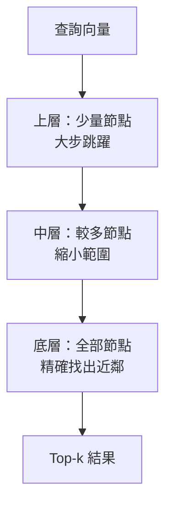
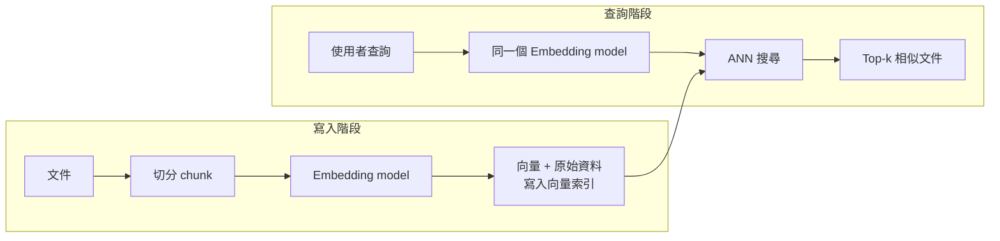
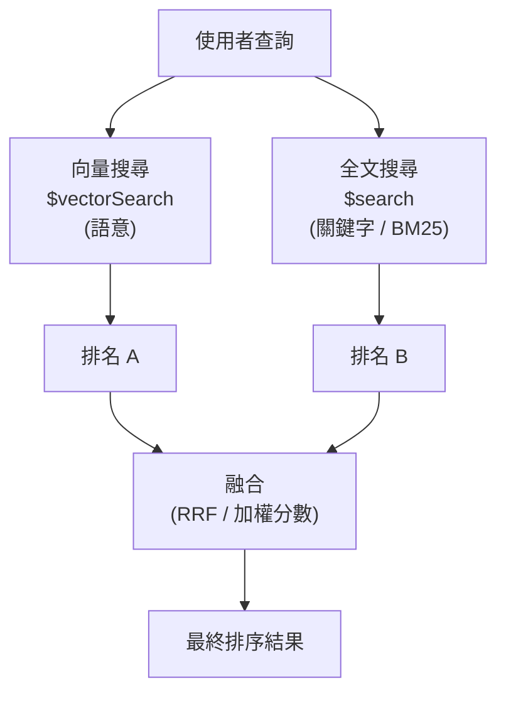
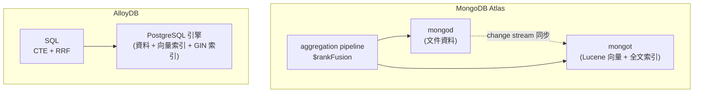

# 向量搜尋的原理，以及 MongoDB 與 AlloyDB 的 Hybrid Search 比較

> 一句話版本：向量搜尋把文字（或圖片）轉成 embedding 向量，用「向量距離」找語意相近的內容；Hybrid Search 則把向量搜尋（懂語意）與全文搜尋（懂關鍵字）的結果合併排序。MongoDB Atlas 以 `$vectorSearch` + `$search` 組合，並用內建的 Reciprocal Rank Fusion（RRF）融合；AlloyDB 則在 PostgreSQL 內用 pgvector / ScaNN + `tsvector`，自己用 SQL 寫 RRF。

## Step 1：為什麼需要向量搜尋

傳統的關鍵字搜尋（SQL 的 `LIKE`、倒排索引 + BM25）是「字面比對」：

| 查詢 | 文件內容 | 關鍵字搜尋 |
|------|----------|-----------|
| 如何退貨 | 申請退款的步驟 | 對不上（沒有共同詞） |
| car | automobile | 對不上（同義詞） |
| Apple 股價 | 蘋果公司財報 | 對不上（跨語言） |

人類是靠「意思」找東西，字面比對天生有 vocabulary mismatch 問題。向量搜尋的做法是：**把意思編碼成一串數字，意思相近的內容，數字也相近**。

## Step 2：Embedding——把語意變成向量

Embedding model 把一段內容映射到高維空間的一個點：

```text
"如何申請退款"   → [0.12, -0.53, 0.88, ..., 0.07]   (例如 1024 維)
"退貨流程說明"   → [0.10, -0.49, 0.91, ..., 0.05]   (距離很近)
"今天天氣很好"   → [-0.77, 0.21, -0.03, ..., 0.64]  (距離很遠)
```

重點：

- 維度由模型決定（常見 384、768、1024、1536、3072），**查詢與文件必須用同一個 embedding model**，否則向量不在同一個空間，距離沒有意義。
- 訓練時模型被迫讓「語意相近的句子」在空間中靠近，所以能處理同義詞、改寫甚至跨語言。
- Embedding model 的選型與評估見 [Embedding Model 的選型考量與評估方法](#/llm/04-applications/how-to-choose-embedding-model.mdx)。

## Step 3：相似度如何計算

兩個向量 $\mathbf{a}$、$\mathbf{b}$ 有三種常見的度量：

$$
\text{cosine}(\mathbf{a},\mathbf{b}) = \frac{\mathbf{a}\cdot\mathbf{b}}{\|\mathbf{a}\|\,\|\mathbf{b}\|}
\qquad
\text{euclidean}(\mathbf{a},\mathbf{b}) = \|\mathbf{a}-\mathbf{b}\|
\qquad
\text{dot}(\mathbf{a},\mathbf{b}) = \mathbf{a}\cdot\mathbf{b}
$$

| 度量 | 看什麼 | 何時用 |
|------|--------|--------|
| cosine | 方向（夾角），忽略長度 | 文字 embedding 最常用 |
| euclidean | 絕對距離 | 向量長度本身有意義時 |
| dotProduct | 方向 + 長度 | 向量已 normalize 時等價 cosine，且最快 |

選哪一種要**跟 embedding model 的訓練方式一致**（模型文件通常會建議）。

## Step 4：從暴力搜尋到 ANN

最直覺的做法是 **KNN / ENN（exact nearest neighbor）**：把查詢向量跟每一筆文件比一次，取最近的 $k$ 筆。複雜度 $O(N \cdot d)$（$N$ 筆資料、$d$ 維），百萬級以上就太慢。

實務上用 **ANN（Approximate Nearest Neighbor）**：用特殊的索引結構，犧牲一點 recall 換取數量級的速度。主流演算法：

| 演算法 | 概念 | 特性 |
|--------|------|------|
| HNSW | 多層的近鄰圖，從稀疏上層往下層逐步逼近 | recall 高、查詢快、吃記憶體 |
| IVF | 先 k-means 分群，只搜尋最近的幾個群 | 記憶體較省，recall 看搜尋群數 |
| 量化（PQ / scalar / binary） | 壓縮向量降低記憶體與計算量 | 省記憶體，損失些許精度 |



ANN 的核心取捨是 **recall、latency、記憶體** 三角——這也是 MongoDB `numCandidates` 參數存在的原因（見下節）。

## Step 5：向量搜尋的完整流程



這正是 RAG 的檢索端，完整脈絡見 [RAG 的核心概念與運作原理](#/llm/04-applications/what-is-rag.mdx)。

## Step 6：MongoDB Atlas Vector Search

MongoDB 的做法是**向量跟原始文件放在同一個 collection**，不需要另外維運一套 vector database，也不用處理「資料庫與向量庫同步」的問題。

> 注意：Vector Search 是 MongoDB Atlas 的功能（背後是獨立的搜尋程序 mongot，基於 Lucene）。自架的 Community / Enterprise 版是否支援以及支援程度，請以官方文件為準。

### 建立向量索引

```json
{
  "fields": [
    {
      "type": "vector",
      "path": "embedding",
      "numDimensions": 1024,
      "similarity": "cosine"
    },
    {
      "type": "filter",
      "path": "lang"
    }
  ]
}
```

- `numDimensions` 必須等於 embedding model 的輸出維度。
- `similarity` 可選 `cosine` / `euclidean` / `dotProduct`。
- `type: "filter"` 的欄位才能在 `$vectorSearch` 內做 pre-filter。

### 查詢：`$vectorSearch`

```javascript
db.articles.aggregate([
  {
    $vectorSearch: {
      index: "vector_index",
      path: "embedding",
      queryVector: queryEmbedding,   // 用同一個 model 把查詢轉成向量
      numCandidates: 200,            // ANN 階段的候選數
      limit: 10,                     // 最終回傳筆數
      filter: { lang: "zh" }         // pre-filter
    }
  },
  {
    $project: {
      title: 1,
      score: { $meta: "vectorSearchScore" }
    }
  }
])
```

| 參數 | 意義 |
|------|------|
| `numCandidates` | ANN 搜尋時考慮的候選數量，越大 recall 越高、越慢；經驗上設為 `limit` 的 10 到 20 倍 |
| `limit` | 最終回傳的筆數 |
| `filter` | 在 ANN 搜尋過程中就過濾（pre-filter），不是搜完再砍，所以不會因過濾而少回結果 |
| `exact: true` | 改走 ENN 精確搜尋（此時不需要 `numCandidates`），資料量小或需要基準比對時使用 |

`$vectorSearch` 必須是 aggregation pipeline 的**第一個 stage**。

## Step 7：向量搜尋的弱點

向量搜尋不是萬靈丹：

| 場景 | 問題 |
|------|------|
| 精確識別碼：`ERR_CONN_RESET`、型號 `RTX-4090`、人名 | embedding 容易把它「語意化」，反而找不到字面完全相同的文件 |
| 罕見專有名詞、縮寫 | 模型沒見過，向量品質差 |
| 需要可解釋性 | 距離分數很難說明「為什麼這篇排第一」 |
| 否定、數字、條件 | 「不含糖」與「含糖」的向量往往非常接近 |

反過來，關鍵字搜尋在這些場景表現很好，卻不懂同義詞與語意。**兩者的強弱剛好互補**，這就是 Hybrid Search 的動機。

## Step 8：Hybrid Search 是什麼

**Hybrid Search = 同時跑語意檢索與關鍵字檢索，再把兩份結果融合成一份排名。**



### 為什麼不能直接把兩個分數相加？

向量搜尋的分數（例如 cosine 轉成 0 到 1）與 BM25 分數（無上限，隨語料變動）**量綱不同**，直接相加或加權會被某一邊的數值範圍主導。常見解法：

1. **Reciprocal Rank Fusion（RRF）**：只用「名次」，不用原始分數。
2. **分數正規化後加權**：先把各自的分數 normalize 到同一範圍再加權（MongoDB 的 `$scoreFusion` 屬於這一類）。

### RRF 公式

對每份文件 $d$，把它在各個排名清單中的名次轉成分數後加總：

$$
\text{RRF}(d) = \sum_{i} \frac{w_i}{k + \text{rank}_i(d)}
$$

- $\text{rank}_i(d)$：$d$ 在第 $i$ 份排名中的名次（從 1 開始；沒出現就不計入）。
- $k$：平滑常數，常用 60，讓前幾名之間的差距不要過度放大。
- $w_i$：各路檢索的權重，預設皆為 1。

範例（$k=60$、權重皆為 1）：

| 文件 | 向量排名 | 全文排名 | RRF 分數 |
|------|---------|---------|----------|
| A | 1 | 3 | 1/61 + 1/63 ≈ 0.0323 |
| B | 2 | 未出現 | 1/62 ≈ 0.0161 |
| C | 5 | 1 | 1/65 + 1/61 ≈ 0.0318 |

A 與 C 在兩邊都有名次，因此勝過只在單邊出現的 B——**兩種檢索都認為相關的文件會浮到最上面**，這正是 RRF 的特性。

## Step 9：MongoDB 中的 Hybrid Search 實作

MongoDB Atlas 有兩個檢索引擎可以組合：

| 引擎 | Stage | 擅長 |
|------|-------|------|
| Atlas Vector Search | `$vectorSearch` | 語意相似 |
| Atlas Search（Lucene，BM25） | `$search` | 關鍵字、片語、模糊比對、highlight、facet |

兩者都要各自建立索引（vector index 與 search index）。

### 做法一：`$rankFusion`（內建，推薦）

`$rankFusion` 是 MongoDB 提供的內建 stage，用 RRF 融合多個子 pipeline 的排名：

```javascript
db.articles.aggregate([
  {
    $rankFusion: {
      input: {
        pipelines: {
          vectorPipeline: [
            {
              $vectorSearch: {
                index: "vector_index",
                path: "embedding",
                queryVector: queryEmbedding,
                numCandidates: 200,
                limit: 20
              }
            }
          ],
          fullTextPipeline: [
            {
              $search: {
                index: "text_index",
                text: { query: "ERR_CONN_RESET 連線重置", path: "content" }
              }
            },
            { $limit: 20 }
          ]
        }
      },
      combination: {
        weights: { vectorPipeline: 0.6, fullTextPipeline: 0.4 }
      },
      scoreDetails: true
    }
  },
  { $limit: 10 },
  {
    $project: {
      title: 1,
      scoreDetails: { $meta: "scoreDetails" }
    }
  }
])
```

要點：

- 每個子 pipeline 必須產生**有排序的結果**（`$vectorSearch`、`$search`、搭配 `$sort` 的 pipeline 等），RRF 才有名次可用。
- `combination.weights` 可調整兩路權重，預設各 1。
- `scoreDetails: true` 可看到每份文件在各子 pipeline 的名次與貢獻，調參與除錯很有用。
- 版本需求：`$rankFusion` 在 MongoDB 8.1 以上提供（發布初期為 public preview）；另有 `$scoreFusion`（8.2 以上）用正規化後的分數融合。實際可用版本與狀態請以官方文件為準。

### 做法二：手動 RRF（舊版本或需要客製）

在 `$rankFusion` 出現之前，常見做法是用 `$unionWith` 把兩路結果串起來，自己算 RRF：

```javascript
db.articles.aggregate([
  { $vectorSearch: { index: "vector_index", path: "embedding",
                     queryVector: queryEmbedding, numCandidates: 200, limit: 20 } },
  { $group: { _id: null, docs: { $push: "$$ROOT" } } },
  { $unwind: { path: "$docs", includeArrayIndex: "rank" } },
  { $addFields: { vs_score: { $divide: [1.0, { $add: ["$rank", 61] }] } } },
  { $project: { _id: "$docs._id", title: "$docs.title", vs_score: 1, fts_score: { $literal: 0 } } },
  {
    $unionWith: {
      coll: "articles",
      pipeline: [
        { $search: { index: "text_index",
                     text: { query: "ERR_CONN_RESET 連線重置", path: "content" } } },
        { $limit: 20 },
        { $group: { _id: null, docs: { $push: "$$ROOT" } } },
        { $unwind: { path: "$docs", includeArrayIndex: "rank" } },
        { $addFields: { fts_score: { $divide: [1.0, { $add: ["$rank", 61] }] } } },
        { $project: { _id: "$docs._id", title: "$docs.title", vs_score: { $literal: 0 }, fts_score: 1 } }
      ]
    }
  },
  { $group: { _id: "$_id", title: { $first: "$title" },
              vs_score: { $sum: "$vs_score" }, fts_score: { $sum: "$fts_score" } } },
  { $addFields: { score: { $add: ["$vs_score", "$fts_score"] } } },
  { $sort: { score: -1 } },
  { $limit: 10 }
])
```

這裡 `$unwind` 的 `includeArrayIndex` 從 0 起算，所以 $k + \text{rank}$ 用 `rank + 61` 對應「名次從 1 起算、$k=60$」。寫起來冗長又容易錯，新版本優先用 `$rankFusion`。

### 做法三：在 `$search` 內組合（Lucene 層）

Atlas Search 也支援在 `$search` 內用 `vectorSearch` operator 搭配 `compound` 的 `should` / `must`，讓向量條件與文字條件在**同一個 Lucene 查詢**中計分。優點是單一階段、能與 `filter` 等 operator 一起用；缺點是分數融合方式受限於 Lucene 計分，調參彈性不如 RRF 直觀。細節與限制請查官方文件。

## Step 10：AlloyDB 的 Hybrid Search

AlloyDB for PostgreSQL 是 Google Cloud 上與 PostgreSQL 相容的託管資料庫。它沒有獨立的搜尋引擎，而是在 PostgreSQL 內用三個零件組出 Hybrid Search：

| 零件 | 機制 | 說明 |
|------|------|------|
| 向量搜尋 | `vector` 型別（pgvector 相容）+ 向量索引 | 索引可選 ScaNN（`alloydb_scann` extension，Google 自家的演算法）、HNSW、IVFFlat |
| 全文搜尋 | PostgreSQL 內建 `tsvector` / `tsquery` + GIN 索引 | 用 `ts_rank` / `ts_rank_cd` 排序，**不是 BM25** |
| 融合 | 自己用 SQL 寫 RRF | 沒有 `$rankFusion` 這種內建 stage，用 CTE + `FULL OUTER JOIN` 組合 |

此外 AlloyDB AI 提供 `embedding()` 等函式（`google_ml_integration` extension），可以在 SQL 內直接呼叫 Vertex AI 產生 embedding，也能搭配 Vertex AI 的 ranking 模型做融合後的 rerank。實際可用的函式與版本以官方文件為準。

### 建表與索引

```sql
CREATE EXTENSION IF NOT EXISTS vector;
CREATE EXTENSION IF NOT EXISTS alloydb_scann;

CREATE TABLE articles (
  id          bigserial PRIMARY KEY,
  title       text,
  content     text,
  lang        text,
  embedding   vector(1024),
  content_tsv tsvector
    GENERATED ALWAYS AS (to_tsvector('simple', content)) STORED
);

-- 全文索引
CREATE INDEX articles_tsv_idx ON articles USING gin (content_tsv);

-- 向量索引（ScaNN；num_leaves 等參數依資料量調整）
CREATE INDEX articles_vec_idx ON articles
  USING scann (embedding cosine)
  WITH (num_leaves = 1000);
```

### 用 SQL 做 RRF

```sql
WITH vec AS (
  SELECT id, ROW_NUMBER() OVER (ORDER BY dist) AS rnk
  FROM (
    SELECT id, embedding <=> $1::vector AS dist
    FROM articles
    WHERE lang = 'zh'
    ORDER BY dist
    LIMIT 20
  ) s
),
fts AS (
  SELECT id, ROW_NUMBER() OVER (ORDER BY score DESC) AS rnk
  FROM (
    SELECT a.id, ts_rank_cd(a.content_tsv, q) AS score
    FROM articles a, websearch_to_tsquery('simple', $2) q
    WHERE a.lang = 'zh' AND a.content_tsv @@ q
    ORDER BY score DESC
    LIMIT 20
  ) s
)
SELECT a.id, a.title,
       COALESCE(1.0 / (60 + vec.rnk), 0)
     + COALESCE(1.0 / (60 + fts.rnk), 0) AS rrf
FROM vec
FULL OUTER JOIN fts USING (id)
JOIN articles a USING (id)
ORDER BY rrf DESC
LIMIT 10;
```

重點：

- `<=>` 是 cosine distance 運算子，`ORDER BY 距離 LIMIT n` 的寫法才能用到向量索引。
- 融合的邏輯完全是 SQL，好處是**可以任意 JOIN、加 `WHERE`、換公式**，壞處是每個專案都要自己維護這段 SQL。
- **中文全文搜尋的陷阱**：PostgreSQL 內建的 text search configuration 沒有中文斷詞，用 `simple` 時整串中文會被當成一個 token，關鍵字路幾乎無效。要處理中文通常需要額外 extension（如 zhparser）或改在應用層斷詞，是否能在 AlloyDB 使用請查官方支援的 extension 清單。Atlas Search 則內建多種語言 analyzer（包含 CJK 系列），這點對中文場景差異很大。

## Step 11：MongoDB 與 AlloyDB 的差異比較



| 面向 | MongoDB Atlas | AlloyDB |
|------|---------------|---------|
| 資料模型 | 文件（JSON），向量是文件內的陣列欄位 | 關聯式表格，向量是 `vector` 欄位 |
| 搜尋引擎架構 | 獨立的 mongot（Lucene），與資料庫節點分離，可用專屬 Search Node 獨立擴展 | 同一個 PostgreSQL 引擎，向量與 GIN 索引都是一般索引 |
| 索引一致性 | 搜尋索引由資料庫非同步同步，寫入後有短暫延遲才搜得到 | 索引隨交易更新，與資料強一致 |
| 向量演算法 | HNSW（Lucene），支援量化 | ScaNN、HNSW、IVFFlat 可選；ScaNN 為 Google 主打（效能數字為官方宣稱，需自行 benchmark） |
| 關鍵字搜尋品質 | Lucene BM25，內建 analyzer、模糊比對、highlight、facet、自動補全 | `tsvector` + `ts_rank`，功能偏基礎，無 BM25、無內建中文斷詞 |
| 融合方式 | 內建 `$rankFusion`（RRF）與 `$scoreFusion`，宣告式、可調權重、有 `scoreDetails` | 手寫 SQL 的 RRF，彈性最大但沒有現成 stage |
| 過濾 | 只有索引中宣告為 `filter` 型別的欄位可 pre-filter | 任意 `WHERE` 條件，搭配 AlloyDB 的 filtered vector search 優化（效果依版本與選擇度而定） |
| 關聯查詢 | `$lookup`，能力有限 | 完整 SQL JOIN、交易、約束 |
| 產生 embedding | 需由應用程式呼叫 model；Atlas 另有整合自動 embedding 的功能，細節以官方文件為準 | 可用 `embedding()` 在 SQL 內呼叫 Vertex AI |
| 部署與生態 | 跨 AWS / GCP / Azure | 僅 Google Cloud；與 BigQuery、Vertex AI 整合緊 |

### 怎麼選

| 情境 | 較適合 |
|------|--------|
| 資料本來就是文件型、schema 常變，且需要成熟的全文搜尋（facet、highlight、多語言 analyzer） | MongoDB Atlas |
| 已經是 PostgreSQL / 關聯式資料，需要 JOIN、交易，向量只是其中一個欄位 | AlloyDB |
| 想要宣告式 Hybrid Search，少寫融合邏輯 | MongoDB Atlas（`$rankFusion`） |
| 需要複雜的過濾條件與融合公式客製，且團隊熟 SQL | AlloyDB |
| 要求搜尋結果與資料強一致（寫入後立刻搜得到） | AlloyDB |
| 中文為主的關鍵字檢索 | 優先評估 Atlas Search；AlloyDB 需額外處理斷詞 |
| 全部在 GCP，且資料量極大、想與 BigQuery、Vertex AI 串接 | AlloyDB |
| 多雲或不想綁定單一雲廠商 | MongoDB Atlas |

兩者的核心哲學差異：**MongoDB 是「資料庫旁掛一個搜尋引擎」**（搜尋能力強、一致性較弱），**AlloyDB 是「在關聯式資料庫內補上向量能力」**（一致性與 SQL 彈性強、搜尋功能較基礎）。若搜尋品質是核心產品需求，另一個選項是專用的搜尋引擎或向量資料庫（如 Elasticsearch、Qdrant），代價是多維運一套系統與資料同步。

## Step 12：實務調校建議

| 面向 | 建議 |
|------|------|
| 權重 | 先用預設 1:1 建立基準，再用評估集（見下）調整；識別碼多的語料偏向全文，自然語言問答偏向向量 |
| 候選數 | 每路各取 20 到 100 筆再融合，太少會漏掉只在單路排名高的文件 |
| Pre-filter | 租戶、語言、時間範圍等硬條件放進 `filter`（vector）與 `compound.filter`（text） |
| Reranking | Hybrid 之後再接 cross-encoder reranker，是 RAG 提升精準度的常見第二階段 |
| 評估 | 建立「查詢 → 標準答案文件」的評估集，用 Recall@k、MRR 比較 vector-only、text-only、hybrid |
| 成本 | 向量索引吃記憶體（HNSW），維度與資料量決定機器規格；可評估量化降低成本 |

## 常見誤區

- **「向量搜尋能取代全文搜尋」**：不能。精確匹配與稀有詞仍是全文搜尋的強項，所以才需要 Hybrid。
- **「換了 embedding model 還能沿用舊向量」**：不行，必須全部重新 embedding 並重建索引。
- **「`numCandidates` 設越大越好」**：recall 提升有邊際遞減，延遲與資源成本卻線性增加。
- **「Hybrid 一定比單路好」**：權重或候選數設定不當時可能反而變差，要用評估集驗證。

## 相關筆記

- [RAG 的核心概念與運作原理](#/llm/04-applications/what-is-rag.mdx)
- [Embedding Model 的選型考量與評估方法](#/llm/04-applications/how-to-choose-embedding-model.mdx)
- [Agent 檔案式記憶與 RAG 的異同](#/llm/04-applications/agent-memory-vs-rag.mdx)
- [ELK Stack 的核心作用與架構](#/sre/02-observability/what-is-elk-stack.mdx)（Elasticsearch 同樣以 Lucene 倒排索引為基礎，並提供 kNN 與 hybrid 能力）
